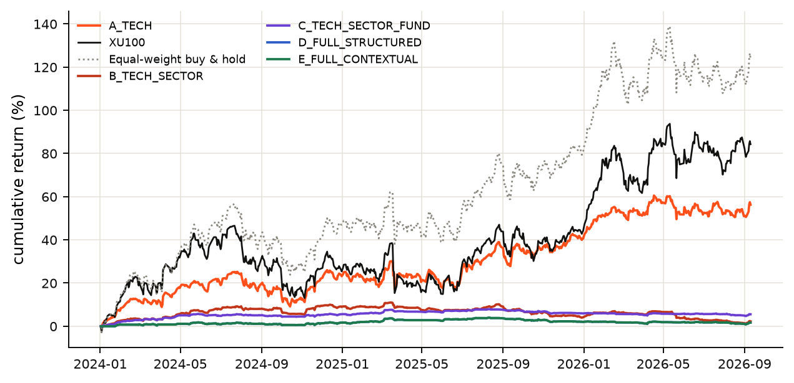

# Backtest results and benchmark comparisons

*FinTreX Analyst research report · analysis date (as_of) 2026-09-10 · period 2024-01-01 to 2026-09-10 · universe:
the 30-stock course universe. Generated by `eval/scenario_reports.py`; every number comes from the `run_backtest`
envelope. Educational analysis; BUY/SELL exist only as educational backtest positions and no order is ever produced.*

## Key findings

- Variants that beat XU100: none. Highest Sharpe (rf = 0): A_TECH (1.21).
- Sharpe against the policy rate is negative for every variant: idle cash earning nothing falls behind the CBRT rate (see the cash-at-policy-rate version below).
- Each added layer removes signals (A 2,266 → B 472 → C 195 → D 165 → E 165). Every variant has at least 10 closed trades. D_FULL_STRUCTURED and E_FULL_CONTEXTUAL are identical: the layer added in E_FULL_CONTEXTUAL filtered no further signal in this period.

## 1. Rule and execution

- **Pre-registered rule** `REVERSAL_PRESET_V1` (fixed before any result was seen; changing it requires a new name): entry
  events `BB_LOWER_REVERSAL`, `RSI_TROUGH_VOLUME`, `SUPERTREND_BULLISH_FLIP`, `SUPPORT_TOUCH`; holding period 5 trading days.
- **Layers** (cumulative from A to E): B — the stock is not lagging its sector over 20 days;
  C — latest reported revenue growth ≥ 0%; D — USD/TRY change over the last
  21 days ≤ 5% and no rate hike in the last 30
  days; E — no regulation, geopolitics news in the last 2 days.
- **Timing:** signal at the close of day t (information ≤ t), trade at the open of t+1, exit at the open
  5 days later. One trade per position; capital split into equal slots; idle slots earn 0%
  (plus a version where idle cash earns the policy rate).
- **Costs:** transaction cost 10 bp, slippage 0 bp.
- **Out of sample:** 2026-01-01 onwards is reported separately.

## 2. Variants

| Variant | Layers | Signals | Trades | Win rate | Cumulative | Real | Sharpe (0 / policy) | Max drawdown | vs XU100 | Out of sample |
| :--- | :--- | ---: | ---: | ---: | ---: | ---: | ---: | ---: | ---: | ---: |
| A_TECH (technical) | technical only | 2,266 | 2,249 | 52.6% | +56.2% | -32.3% | 1.21 / -1.25 | -12.8% | -28.1 pp | +11.1% |
| B_TECH_SECTOR (technical + sector) | sector | 472 | 470 | 48.9% | +2.3% | -55.7% | 0.24 / -9.44 | -8.8% | -82.0 pp | -1.8% |
| C_TECH_SECTOR_FUND (technical + sector + fundamentals) | sector, fundamental | 195 | 194 | 56.2% | +5.5% | -54.2% | 1.13 / -18.93 | -3.0% | -78.8 pp | -0.3% |
| D_FULL_STRUCTURED (all structured data) | sector, fundamental, macro | 165 | 164 | 50.6% | +1.7% | -55.9% | 0.38 / -21.26 | -3.0% | -82.6 pp | -0.3% |
| E_FULL_CONTEXTUAL (structured + news context) | sector, fundamental, macro, news | 165 | 164 | 50.6% | +1.7% | -55.9% | 0.38 / -21.26 | -3.0% | -82.6 pp | -0.3% |

\* Fewer than 10 closed trades: a high return from few events is unreliable.

## 3. Benchmarks

| Benchmark | Cumulative | Sharpe | Max drawdown |
| :--- | ---: | ---: | ---: |
| Equal-weight buy & hold (30 stocks) | +124.1% | 1.39 | -21.0% |
| XU100 | +84.3% | 1.09 | -22.9% |
| Sector basket | +86.0% | 1.13 | -19.9% |

## 4. Idle cash at the policy rate

In Türkiye the opportunity cost of cash is high. If idle slots had earned the CBRT policy rate of the day:

| Variant | Cumulative | Real | Sharpe (vs policy) | Mean exposure |
| :--- | ---: | ---: | ---: | ---: |
| A_TECH | +138.8% | +3.5% | -0.17 | 56% |
| B_TECH_SECTOR | +139.8% | +4.0% | -0.89 | 12% |
| C_TECH_SECTOR_FUND | +164.4% | +14.6% | 0.15 | 5% |
| D_FULL_STRUCTURED | +156.6% | +11.2% | -0.52 | 4% |
| E_FULL_CONTEXTUAL | +156.6% | +11.2% | -0.52 | 4% |

## 5. Limitations

- One rule, one universe, about 2.7 years; no parameter search was done (to limit data-mining risk).
- Overnight gaps and partial fills are not modelled; BIST price limits and limit-locked days are ignored.
- Prices are dividend- and split-adjusted; no taxes.

## Appendix — source tool call

Data version: fundamentals `41b26fc0d037`, macro `7c8f1f74f52e`, news `cfba92ab38d9`, prices `330c06c5e4c9`

**Additional tool calls for comparison** (outside the harness run; same snapshot and as_of)

| Scope | Tool | call_id |
| :--- | :--- | :--- |
| course universe, five variants | `run_backtest` | `315e68acbc9742b9` |
