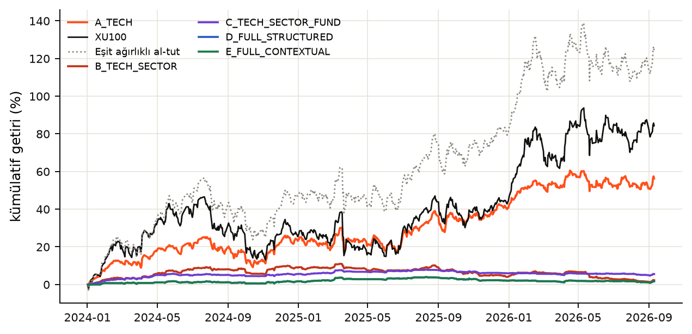

# Backtest sonuçları ve kıyaslar

*FinTreX Analyst raporu · analiz tarihi 10.09.2026 · dönem 01.01.2024 – 10.09.2026 ·
evren: 30 hisselik ders evreni. Bu rapor `eval/scenario_reports.py` ile araç çıktılarından üretilmiştir; her sayı
`run_backtest` zarfından gelir. Eğitsel bir analizdir; BUY/SELL yalnızca eğitsel backtest pozisyonudur, hiçbir emir
üretilmez.*

## Ana bulgular

- Beş varyanttan XU100'ü geçenler: yok. En yüksek Sharpe (rf = 0): A_TECH (1,21).
- Politika faizine göre Sharpe tüm varyantlarda negatif:
  boşta nakit tutmak TCMB faizi kadar kazandırmadığı için strateji faizin gerisinde kalıyor (aşağıda nakit faizli sürüm).
- Katman ekledikçe sinyal sayısı düşüyor (A 2.266 → B 472 → C 195 → D 165 → E 165). Her varyantta en az 10 kapanmış işlem var. D_FULL_STRUCTURED ve E_FULL_CONTEXTUAL sonuçları birebir aynı: E_FULL_CONTEXTUAL varyantına eklenen katman bu dönemde ek sinyal elemedi.

## 1. Kural ve yürütme

- **Önceden sabitlenmiş kural** `REVERSAL_PRESET_V1` (sonuçlara bakılmadan seçildi; değiştirmek yeni bir ad gerektirir):
  giriş olayları `BB_LOWER_REVERSAL`, `RSI_TROUGH_VOLUME`, `SUPERTREND_BULLISH_FLIP`, `SUPPORT_TOUCH`; elde tutma 5 işlem günü.
- **Katmanlar** (A → E birikimli): B sektörde geride olmayan (20 günlük pencere), C son raporda hasılat
  büyümesi ≥ %0, D son 21 günde USD/TRY değişimi ≤
  %5 ve son 30 günde faiz artışı yok,
  E son 2 günde regulation, geopolitics haberi yok.
- **Zamanlama:** sinyal t kapanışında (bilgi ≤ t), işlem t+1 açılışında; çıkış 5 gün sonra açılışta.
  Pozisyon başına tek işlem, sermaye eşit bölmelere ayrılır, boştaki bölme %0 getirir (ayrıca politika faizli sürüm).
- **Maliyet:** işlem maliyeti 10 baz puan, kayma 0 baz puan.
- **Örneklem dışı:** 01.01.2026 ve sonrası ayrı raporlanır.

## 2. Varyantlar

| Varyant | Katmanlar | Sinyal | İşlem | Kazanan | Kümülatif | Reel | Sharpe (0 / faiz) | En büyük düşüş | XU100 farkı | Örneklem dışı |
| :--- | :--- | ---: | ---: | ---: | ---: | ---: | ---: | ---: | ---: | ---: |
| A_TECH (Teknik) | yalnız teknik | 2.266 | 2.249 | %52,6 | +%56,2 | -%32,3 | 1,21 / -1,25 | -%12,8 | -28,1 puan | +%11,1 |
| B_TECH_SECTOR (Teknik + sektör) | sector | 472 | 470 | %48,9 | +%2,3 | -%55,7 | 0,24 / -9,44 | -%8,8 | -82,0 puan | -%1,8 |
| C_TECH_SECTOR_FUND (Teknik + sektör + temel) | sector, fundamental | 195 | 194 | %56,2 | +%5,5 | -%54,2 | 1,13 / -18,93 | -%3,0 | -78,8 puan | -%0,3 |
| D_FULL_STRUCTURED (Tüm yapısal veri) | sector, fundamental, macro | 165 | 164 | %50,6 | +%1,7 | -%55,9 | 0,38 / -21,26 | -%3,0 | -82,6 puan | -%0,3 |
| E_FULL_CONTEXTUAL (Yapısal + bağlam) | sector, fundamental, macro, news | 165 | 164 | %50,6 | +%1,7 | -%55,9 | 0,38 / -21,26 | -%3,0 | -82,6 puan | -%0,3 |

\* 10'dan az kapanmış işlem: yüksek getiri az olaydan geliyorsa güvenilmez.

## 3. Kıyaslar

| Kıyas | Kümülatif | Sharpe | En büyük düşüş |
| :--- | ---: | ---: | ---: |
| Eşit ağırlıklı al-tut (30 hisse) | +%124,1 | 1,39 | -%21,0 |
| XU100 | +%84,3 | 1,09 | -%22,9 |
| Sektör sepeti | +%86,0 | 1,13 | -%19,9 |

## 4. Boştaki nakit politika faiziyle

Türkiye'de nakdin fırsat maliyeti yüksektir. Boştaki bölmeler o günkü TCMB politika faiziyle değerlendirilseydi:

| Varyant | Kümülatif | Reel | Sharpe (faize göre) | Ortalama yatırım oranı |
| :--- | ---: | ---: | ---: | ---: |
| A_TECH | +%138,8 | +%3,5 | -0,17 | %56 |
| B_TECH_SECTOR | +%139,8 | +%4,0 | -0,89 | %12 |
| C_TECH_SECTOR_FUND | +%164,4 | +%14,6 | 0,15 | %5 |
| D_FULL_STRUCTURED | +%156,6 | +%11,2 | -0,52 | %4 |
| E_FULL_CONTEXTUAL | +%156,6 | +%11,2 | -0,52 | %4 |

## 5. Sınırlar

- Tek kural, tek evren, ~2,7 yıl; parametre araması yapılmadı (veri madenciliği riskini azaltmak için).
- Kapanış–açılış arası boşluk ve kısmi dolum modellenmedi; BIST fiyat marjı ve tavan/taban kilitleri yok sayıldı.
- Temettü ve bölünme düzeltmeli fiyatlar kullanıldı; vergi yok.

## Ek — kaynak araç çağrısı

Veri sürümü: fundamentals `41b26fc0d037`, macro `7c8f1f74f52e`, news `cfba92ab38d9`, prices `330c06c5e4c9`

**Karşılaştırma için ek araç çağrıları** (harness dışı, aynı snapshot ve as_of)

| Kapsam | Araç | call_id |
| :--- | :--- | :--- |
| ders evreni, 5 varyant | `run_backtest` | `315e68acbc9742b9` |
