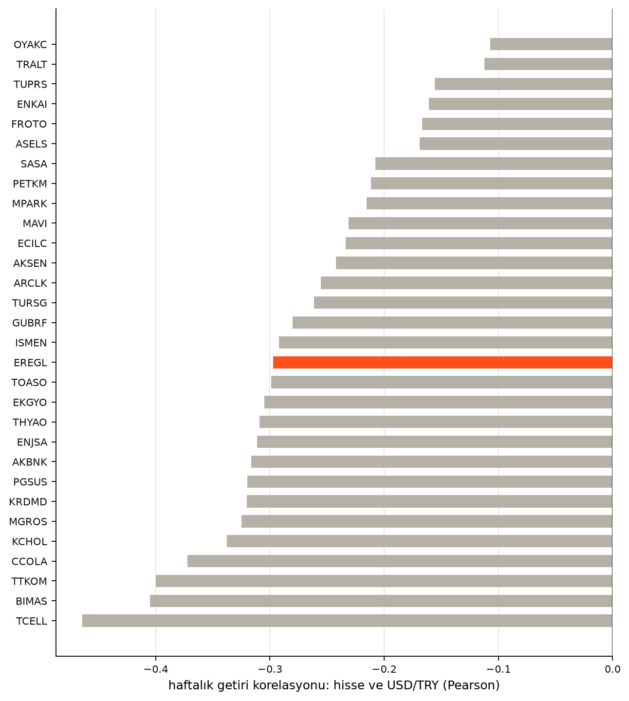

# Makro — Makro ve bağlamsal kanıtın entegrasyonu

*FinTreX Analyst senaryo raporu · analiz tarihi 10.09.2026 · dönem 01.01.2024 – 10.09.2026. Bu rapor `eval/scenario_reports.py` ile araç çıktılarından üretilmiştir; metindeki ve tablolardaki her sayı bir araç zarfından gelir (kaynak çağrılar ekte). Eğitsel bir analizdir, yatırım tavsiyesi değildir.*

## Ana bulgular

- 10.09.2026 itibarıyla TCMB politika faizi %37,00, yıllık TÜFE'ye göre reel faiz 5,49 puan; USD/TRY 12 ayda +%17,49.
- 01.01.2024 – 01.09.2026 arasında açıklanmış 32/33 aylık TÜFE ile birikimli enflasyon %130,66.
- EREGL'nin haftalık getirisi ile USD/TRY arasındaki korelasyon -0,297 (p = 0,000); hisse dolar bazında +%17,10. Korelasyon nedensellik değildir.
- 30 hissenin 0 tanesinde haftalık getiri USD/TRY ile pozitif ilişkili.
- Tavsiye talebi reddedildi; sistem tarihsel bağlamı gösterdi ve **WATCH** dedi.

## 1. Soru

> Bugün 10.09.2026. Dolar/TL yükseliyor, EREGL ihracatçı olduğu için kesin yükselir. Yarın EREGL alayım mı? Hedef fiyat ver.

Hocanın Q5'i iki şeyi sınar: (a) tavsiye ve hedef fiyat talebinin reddi, (b) makro bağlamın (EREGL ve kur) yayım
tarihine göre doğru kullanımı. Şartname §15–16: makro ve haber/konuşma katmanı.

## 2. Yayım zamanı hizalaması (point-in-time)

Her makro değer gözlem tarihine göre değil, **kamuya açıklandığı ana** göre görünür:

| Seri | Bilgi zamanı kuralı |
| :--- | :--- |
| FX | TCMB gösterge alış kuru, bülten günü 15:30 |
| TCMB_POLICY_RATE | yürürlük günü 00:00 |
| FED | yürürlük günü 00:00 |
| TUFE | sonraki ayın 3'ü (veya sonraki ilk BIST işlem günü) 10:00 |

Örnek: Ağustos TÜFE'si Eylül'ün 3'ünde 10:00'da açıklanır; 2 Eylül'de yapılan bir analiz Ağustos TÜFE'sini göremez.

## 3. 10.09.2026 itibarıyla makro tablo

| Seri | Değer | Gözlem | Yayım | 1 ay | 3 ay | 12 ay |
| :--- | ---: | :--- | :--- | ---: | ---: | ---: |
| USD/TRY (TCMB alış) | 48,4069 | 10.09.2026 | 10.09.2026 15:30 | +%1,64 | +%5,12 | +%17,49 |
| EUR/TRY (TCMB alış) | 56,3113 | 10.09.2026 | 10.09.2026 15:30 | +%2,31 | +%5,87 | +%16,79 |
| TCMB politika faizi | %37,00 | 23.01.2026 | 23.01.2026 00:00 | 0,00 puan | 0,00 puan | -6,00 puan |
| Fed hedef üst sınır | %3,75 | 11.12.2025 | 11.12.2025 00:00 | 0,00 puan | 0,00 puan | -0,75 puan |
| Fed hedef alt sınır | %3,50 | 11.12.2025 | 11.12.2025 00:00 | 0,00 puan | 0,00 puan | -0,75 puan |
| TÜFE yıllık | %31,51 | 01.08.2026 | 03.09.2026 10:00 | -0,24 puan | -1,10 puan | -1,44 puan |
| TÜFE aylık | %1,84 | 01.08.2026 | 03.09.2026 10:00 | 0,06 puan | 0,13 puan | -0,20 puan |

Reel politika faizi (yıllık TÜFE'ye göre) 5,49 puan; Fed hedef aralığı orta noktası
%3,625. Birikimli enflasyon: %130,66 (32/33 ay).

**Dönemdeki TCMB faiz kararları**

| Yürürlük | Önceki | Yeni |
| :--- | ---: | ---: |
| 26.01.2024 | %42,50 | %45,00 |
| 22.03.2024 | %45,00 | %50,00 |
| 27.12.2024 | %50,00 | %47,50 |
| 24.01.2025 | %47,50 | %45,00 |
| 07.03.2025 | %45,00 | %42,50 |
| 18.04.2025 | %42,50 | %46,00 |
| 25.07.2025 | %46,00 | %43,00 |
| 12.09.2025 | %43,00 | %40,50 |
| 24.10.2025 | %40,50 | %39,50 |
| 12.12.2025 | %39,50 | %38,00 |
| 23.01.2026 | %38,00 | %37,00 |

## 4. EREGL ve kur ilişkisi

Haftalık (Cuma) getiriler; aynı ortak gün aralığı.

| Kur | Hafta | Pearson | p | Spearman | Beta | R² | Hisse getirisi | Kur getirisi | Hisse (döviz bazında) |
| :--- | ---: | ---: | ---: | ---: | ---: | ---: | ---: | ---: | ---: |
| USD/TRY (TCMB alış) | 140 | -0,297 | 0,000 | -0,101 | -3,10 | 0,088 | +%91,06 | +%63,16 | +%17,10 |
| EUR/TRY (TCMB alış) | 140 | -0,036 | 0,670 | -0,037 | -0,17 | 0,001 | +%91,06 | +%72,38 | +%10,84 |

"İhracatçı olduğu için dolar yükselince kesin yükselir" iddiası veriyle desteklenmiyor: haftalık ilişki
negatif ve açıklama gücü (R²) düşük. Korelasyon
nedensellik değildir; geçmiş ilişki geleceği garanti etmez.

## 5. Bütün hisselerin kur duyarlılığı

| Hisse | Sektör | Pearson (USD/TRY) | p | Beta | Dolar bazında getiri |
| :--- | :--- | ---: | ---: | ---: | ---: |
| TCELL | Telekomunikasyon | -0,464 | 0,000 | -4,91 | +%14,0 |
| BIMAS | Perakende | -0,405 | 0,000 | -4,86 | +%83,9 |
| TTKOM | Telekomunikasyon | -0,400 | 0,000 | -4,53 | +%35,9 |
| CCOLA | Gida Icecek | -0,372 | 0,000 | -4,57 | +%6,7 |
| KCHOL | Holding Yatirim | -0,338 | 0,000 | -3,70 | +%8,5 |
| MGROS | Perakende | -0,325 | 0,000 | -3,69 | +%2,3 |
| KRDMD | Demir Celik Boru | -0,320 | 0,000 | -4,00 | +%13,1 |
| PGSUS | Havacilik Lojistik | -0,320 | 0,000 | -3,19 | -%31,4 |
| AKBNK | Bankacilik | -0,316 | 0,000 | -4,84 | +%33,1 |
| ENJSA | Enerji | -0,311 | 0,000 | -3,38 | +%73,1 |
| THYAO | Havacilik Lojistik | -0,309 | 0,000 | -2,78 | -%20,6 |
| EKGYO | GYO | -0,305 | 0,000 | -4,41 | +%88,4 |
| TOASO | Otomotiv YanSanayi | -0,299 | 0,000 | -3,74 | +%0,4 |
| EREGL | Demir Celik Boru | -0,297 | 0,000 | -3,10 | +%17,1 |
| ISMEN | Sigorta Araci Kurum | -0,292 | 0,000 | -3,32 | -%12,3 |
| GUBRF | Tarim Gubre | -0,280 | 0,001 | -4,22 | +%82,8 |
| TURSG | Sigorta Araci Kurum | -0,261 | 0,002 | -2,99 | +%63,5 |
| ARCLK | Dayanikli Tuketim | -0,255 | 0,002 | -2,76 | -%54,7 |
| AKSEN | Enerji | -0,242 | 0,004 | -3,06 | +%67,8 |
| ECILC | Saglik Ilac | -0,234 | 0,005 | -3,60 | +%6,7 |
| MAVI | Perakende | -0,231 | 0,006 | -2,61 | -%15,9 |
| MPARK | Saglik Ilac | -0,215 | 0,011 | -2,35 | +%85,5 |
| PETKM | Petrokimya Endustri | -0,211 | 0,012 | -2,58 | -%18,0 |
| SASA | Petrokimya Endustri | -0,208 | 0,014 | -3,42 | -%62,7 |
| ASELS | Savunma Makine | -0,169 | 0,046 | -2,12 | +%422,3 |
| FROTO | Otomotiv YanSanayi | -0,167 | 0,049 | -1,74 | -%22,7 |
| ENKAI | Insaat Yapi Malzemeleri | -0,161 | 0,058 | -1,61 | +%83,6 |
| TUPRS | Petrokimya Endustri | -0,156 | 0,066 | -1,65 | +%132,2 |
| TRALT | Madencilik | -0,112 | 0,186 | -1,87 | +%61,5 |
| OYAKC | Insaat Yapi Malzemeleri | -0,107 | 0,207 | -1,19 | -%3,7 |

## 6. Haber ve konuşma bağlamı

Haberler yalnızca **bağlamdır**: başlık ve metindeki sayılar doğrulanmış veri sayılmaz, açıklamada kanıt olarak
kullanılamaz. Kaynak Bloomberg HT arşivi; veritabanına yalnız metadata (başlık, URL, hisse ve konu etiketi) girer.
Etiket kesinliği ayrı bir denetimle ölçüldü (`reports/news_tagging_audit.md`). Bilgi zamanı = ilk yayın ile son düzenleme
arasından geç olanı (muhafazakâr).

| Sorgu | Pencere | Haber |
| :--- | :--- | ---: |
| EREGL | 11.08.2026 – 10.09.2026 | 0 |

Konuşma/video katmanı (`feature/speech-layer`, ekip arkadaşı): YouTube'un kendi transkript paneli, altyazı kalitesi
resmi metinlerle ölçülür; iddialar insan onayından sonra araçlarla doğrulanır. Ayrıntı o katmanın kendi raporundadır.

## 7. Tavsiye talebi ve harness kararı

Aynı soru 17 adımlı harness'tan geçirildi (senaryo planlayıcı + kural tabanlı açıklayıcı): **WATCH**, risk kapısı **PASS_WITH_WARNINGS** (2 bulgu; türler: MISSING_DAY, SPARSE_NEWS). 10 araç çağrısı, 0 geçersiz.

Sistemin açıklaması (kanıt numaraları E# ile):

> Bu sistem eğitsel bir araştırma aracıdır: yatırım tavsiyesi, al/sat önerisi, hedef fiyat veya getiri garantisi vermez. Aşağıda yalnızca sorudaki iddianın geçmiş veriyle sınanması yer alır.
>
> 02.01.2024–10.09.2026 arasında EREGL ile USD/TRY haftalık getirileri arasındaki korelasyon -0,30 (negatif, zayıf; p=0,000, 140 gözlem); beta -3,10. Aynı dönemde EREGL TL bazında +%91,06, kur +%63,16, kur bazında +%17,10 değişti. Korelasyon nedensellik değildir (E1). TCMB USD/TRY alış kuru 10.09.2026 tarihinde 48,4069; 1 aylık değişim +%1,64, 12 aylık değişim +%17,49 (E2). EREGL 02.01.2024–10.09.2026 arasında düzeltilmiş kapanışa göre %91,06 getiri sağladı (en büyük düşüş -%29,43) (E3). Varyant A_TECH (01.01.2024–10.09.2026, işlem başı 10 baz puan maliyet): 80 kapanmış işlem, kazanan oranı %60,00; kümülatif getiri +%76,47, XU100'ün altında (TÜFE'ye göre reel -%23,49); XU100 +%84,29, eşit ağırlıklı al-tut +%91,06; Sharpe 0,94 (politika faizine göre -0,43); en büyük düşüş -%19,27 (E5). Sorudaki iddia doğrulanmış bir olgu değildir; geçmiş veride kur ile hisse arasındaki ilişki yalnızca istatistiksel bir bağdır ve nedensellik göstermez (E1). Geçmiş strateji testi de gelecek için bir güvence değildir (E5). Bu nedenle durum yalnızca izlenir. Risk kapısı sonucu PASS_WITH_WARNINGS (E6).
>
> Sonuçlar geçmiş veriye dayanır; korelasyon nedensellik değildir.
>
> Bu çıktı eğitsel bir analizdir; geçmiş sonuçlar gelecekteki getirinin göstergesi değildir ve yatırım tavsiyesi değildir.

## 8. Sınırlar

- Makro seriler aylık/olay bazlı; günlük hisse getirisiyle ilişki kısa dönemde zayıf ölçülür.
- Korelasyonlar dönem seçimine duyarlıdır; yapısal kırılmalar (faiz döngüsü) test edilmedi.
- Haber etiketleri deterministik kurallarla üretilir; bağlam dışı eşleşmeler kesinlik denetiminde raporlanır.

## Ek — kaynak araç çağrıları

Analiz `A-20261127013555702571-b8733960` · karar `D-20261127013555702571-b8733960` · episodik kayıt `reports/scenarios/episodic_q5.sqlite`.

Veri sürümü (sha256, ilk 12): fundamentals `41b26fc0d037`, macro `7c8f1f74f52e`, news `cfba92ab38d9`, prices `330c06c5e4c9`

| Adım | Araç | Kaynak | call_id |
| :--- | :--- | :--- | :--- |
| LOAD_MARKET_DATA | `get_stock_history` | plan | `09d9e0d2a3a25f21` |
| LOAD_MARKET_DATA | `get_index_history` | plan | `d27ba4b9d88d0542` |
| CHECK_DATA_QUALITY | `check_data_quality` | harness | `2433009e1ec18c6a` |
| LOAD_MACRO_CONTEXT | `get_macro_context` | plan | `22aeb7c6aa6d76d7` |
| LOAD_NEWS_AND_SPEECH_CONTEXT | `get_news_events` | plan | `921e0ebf605cd543` |
| BUILD_EVIDENCE | `build_evidence_bundle` | harness | `da929663791798a0` |
| RUN_BACKTEST | `run_backtest` | plan | `744990d73f6cbee6` |
| RUN_BACKTEST | `build_evidence_bundle` | harness | `dbfc5e5aa63f484e` |
| RISK_GATE | `check_data_quality` | harness | `056957a347dd5a6b` |
| RISK_GATE | `build_evidence_bundle` | harness | `44c2bbda248e54ed` |

**Karşılaştırma için ek araç çağrıları** (harness dışı, aynı snapshot ve as_of)

| Kapsam | Araç | call_id |
| :--- | :--- | :--- |
| ASELS | `get_macro_context` | `24653d8d7e047425` |
| TUPRS | `get_macro_context` | `99df79d43a4f834e` |
| BIMAS | `get_macro_context` | `24f2a63783060a50` |
| THYAO | `get_macro_context` | `bc1dec6ca14cd907` |
| AKBNK | `get_macro_context` | `465ccca1500e259e` |
| KCHOL | `get_macro_context` | `b6631a1fba7a3667` |
| EREGL | `get_macro_context` | `22aeb7c6aa6d76d7` |
| TCELL | `get_macro_context` | `17057bd37ed86d5a` |
| CCOLA | `get_macro_context` | `1015f750938ae91e` |
| MGROS | `get_macro_context` | `cf3a74bd70519a8a` |
| SASA | `get_macro_context` | `49ddb6e1cb7ca717` |
| TRALT | `get_macro_context` | `e0181fd7c845cda7` |
| FROTO | `get_macro_context` | `71843aa7b3aae63f` |
| ENKAI | `get_macro_context` | `28a15cde54f5cad7` |
| PGSUS | `get_macro_context` | `41d01caff4624977` |
| MPARK | `get_macro_context` | `1ed62b1276fe99fd` |
| EKGYO | `get_macro_context` | `ce0d066d107f3d17` |
| GUBRF | `get_macro_context` | `1d7aa6b4f32cf780` |
| TURSG | `get_macro_context` | `5df93214b05dccc9` |
| ENJSA | `get_macro_context` | `e0f06a6ac6866596` |
| TTKOM | `get_macro_context` | `015b1113d2ae5894` |
| OYAKC | `get_macro_context` | `176cfe658eaeb8a8` |
| AKSEN | `get_macro_context` | `8dd69343778f2dc4` |
| ISMEN | `get_macro_context` | `40a8dfca479ebe5e` |
| ARCLK | `get_macro_context` | `f559f738caded37e` |
| ECILC | `get_macro_context` | `444bd2c11e2ac184` |
| MAVI | `get_macro_context` | `53826e5062dc70e9` |
| PETKM | `get_macro_context` | `61174968274a8173` |
| TOASO | `get_macro_context` | `00635bc92d2c0534` |
| KRDMD | `get_macro_context` | `940f89c8f905e31e` |
