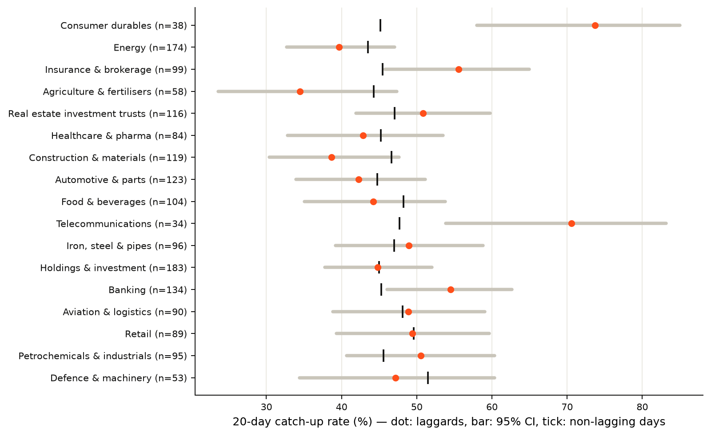

# S1 — Sector laggards and catch-up: Retail

*FinTreX Analyst research report · analysis date (as_of) 2026-09-10 · period 2024-01-01 to 2026-09-10. Generated by `eval/scenario_reports.py` from tool outputs: every number in the text and tables comes from a tool envelope (source calls in the appendix). Educational analysis, not investment advice.*

## Key findings

- Over the last 20 trading days the Retail sector median returned +6.20% versus +1.85% for XU100: the sector is strong. Laggards: MAVI, MGROS; leaders: SOKM.
- Lagging also over longer windows (structural candidates): MAVI, MGROS.
- Between 2024-01-01 and 2026-09-10, 93 laggard entries had a 20-day catch-up rate of 49.4% versus 49.6% on non-lagging days; 45 false positives.
- Across 17 sectors the laggards' 20-day catch-up rate beats the baseline in 8, and the difference is significant (p < 0.05) in 3.
- Backtest `B_TECH_SECTOR`: +9.01%, -75.29 pp versus XU100.

## 1. Question

> Which of BIMAS, MGROS and MAVI lagged the sector median over the last 20 trading days? Between 2024 and 2026, what were the 5/10/20-day catch-up rates and false positives of laggards; is the lag explained by fundamental or macro reasons? Is POTENTIAL_CATCH_UP_CANDIDATE appropriate?

*(Instructor's golden question Q1; the original Turkish wording is in `eval/golden_questions.json`.)*

Specification §11: do stocks that lag a strong sector later catch up with it; is the lag structural or temporary; how many false positives are there.

## 2. Method

- **Peer group:** the TÜBİTAK 95-stock sector map (`config/universe.yaml: peer_groups`). The whole sector of each
  requested stock is used, not only the stocks named in the question (BIMAS, MGROS, SOKM, MAVI).
- **Lag score:** stock return − median return of the OTHER members (leave-one-out). Threshold -5.00 pp.
- **Strong sector:** group median > 0 and > XU100 over the same window.
- **Event:** ENTRY into the laggard state in a strong sector (one event per episode, not every day).
- **Catch-up:** stock return − equal-weight basket of the other members > 0 over the next h days; otherwise a false
  positive. Benchmark: the same rate on non-lagging days. Events without a complete forward window are excluded.

## 3. Current ranking (2026-09-10, last 20 trading days)

| Stock | Return | Median of other members | Lag score | Rank | vs XU100 |
| :--- | ---: | ---: | ---: | ---: | ---: |
| SOKM | +14.88% | -1.81% | +16.69 pp | 1/4 | +13.03 pp |
| BIMAS | +14.21% | -1.81% | +16.02 pp | 2/4 | +12.36 pp |
| MGROS | -1.81% | +14.21% | -16.02 pp | 3/4 | -3.66 pp |
| MAVI | -5.06% | +14.21% | -19.27 pp | 4/4 | -6.91 pp |

**Lag score over several windows**

| Stock | 5d | 10d | 20d | 60d |
| :--- | ---: | ---: | ---: | ---: |
| BIMAS | -0.30 pp | +7.09 pp | +16.02 pp | +25.09 pp |
| MGROS | +0.86 pp | -7.66 pp | -16.02 pp | -32.83 pp |
| SOKM | +0.30 pp | +10.80 pp | +16.69 pp | +37.06 pp |
| MAVI | -2.54 pp | -7.09 pp | -19.27 pp | -25.09 pp |

**Sector strength**

| Window | Group median | XU100 | State |
| :--- | ---: | ---: | :--- |
| 5d | +4.33% | +3.31% | strong |
| 10d | +0.38% | -1.25% | strong |
| 20d | +6.20% | +1.85% | strong |
| 60d | -0.13% | -0.19% | not strong |

## 4. Do laggards historically catch up?

| Horizon | n | Caught up | False positives | Rate [95% CI] | Non-lagging days | Median relative | p |
| :--- | ---: | ---: | ---: | ---: | ---: | ---: | ---: |
| 5d | 91 | 39 | 52 | 42.9% [33%–53%] | 48.9% | -0.24 pp | 0.294 |
| 10d | 91 | 46 | 45 | 50.5% [40%–61%] | 49.0% | +0.21 pp | 0.834 |
| 20d | 89 | 44 | 45 | 49.4% [39%–60%] | 49.6% | -0.14 pp | 1.000 |

**Most recent false positives** (the lagging stock kept underperforming the basket)

| Date | Stock | Lag score | 5d relative | 10d relative | 20d relative |
| :--- | :--- | ---: | ---: | ---: | ---: |
| 2026-06-03 | SOKM | -8.33 pp | -1.34 pp | -1.40 pp | -0.14 pp |
| 2026-07-16 | MAVI | -6.30 pp | -4.61 pp | -4.09 pp | -0.79 pp |
| 2026-07-16 | MGROS | -11.52 pp | -0.49 pp | +1.11 pp | -9.45 pp |
| 2026-07-20 | MGROS | -9.83 pp | -0.24 pp | -0.34 pp | -9.10 pp |
| 2026-07-27 | MGROS | -11.56 pp | -0.12 pp | +5.18 pp | -15.66 pp |
| 2026-07-31 | MAVI | -8.90 pp | -1.57 pp | +1.67 pp | -5.20 pp |
| 2026-08-06 | MGROS | -5.02 pp | -12.28 pp | -15.83 pp | -22.34 pp |
| 2026-08-10 | MAVI | -6.51 pp | +2.57 pp | -4.30 pp | -7.14 pp |

## 5. Structural or temporary?

Stocks lagging over longer windows too: **MAVI, MGROS**. Latest reports (from the
same harness run; only reports disclosed by 2026-09-10):

| Stock | Period | Disclosed | EBITDA margin | Net margin | Revenue (YoY, YTD) |
| :--- | :--- | :--- | ---: | ---: | ---: |
| BIMAS | 2026Q2 | 2026-08-17 22:35 | 4.75% → 5.42% | 3.04% → 3.32% | +9.9% |
| MGROS | 2026Q2 | 2026-08-11 21:43 | 4.84% → 4.55% | 1.46% → 0.42% | +4.5% |
| MAVI | 2026Q1 | 2026-06-09 18:18 | 18.52% → 19.01% | 4.81% → 5.40% | -1.9% |

A lag in a stock whose margins fell suggests the price reflects a fundamental deterioration (structural candidate); a
lag in a stock with improving margins may be temporary. The split is not conclusive, which is why the system only
gives a candidate label with backtest evidence.

## 6. All sectors

The same study for every sector of the 30-stock course universe (20-day horizon):

| Sector | Members | Events | Catch-up | Baseline | False positives | Median relative | p |
| :--- | ---: | ---: | ---: | ---: | ---: | ---: | ---: |
| Defence & machinery | 2 | 53 | 47.2% | 51.5% | 28 | -2.23 pp | 0.583 |
| Petrochemicals & industrials | 5 | 95 | 50.5% | 45.6% | 47 | +0.06 pp | 0.355 |
| Retail | 4 | 89 | 49.4% | 49.6% | 45 | -0.14 pp | 1.000 |
| Aviation & logistics | 5 | 90 | 48.9% | 48.1% | 46 | -0.32 pp | 0.916 |
| Banking | 8 | 134 | 54.5% | 45.3% | 61 | +0.36 pp | 0.037 |
| Holdings & investment | 10 | 183 | 44.8% | 45.0% | 101 | -1.72 pp | 1.000 |
| Iron, steel & pipes | 5 | 96 | 49.0% | 47.0% | 49 | -0.31 pp | 0.759 |
| Telecommunications | 2 | 34 | 70.6% | 47.7% | 10 | +2.09 pp | 0.009 |
| Food & beverages | 5 | 104 | 44.2% | 48.2% | 58 | -1.25 pp | 0.434 |
| Automotive & parts | 10 | 123 | 42.3% | 44.8% | 71 | -0.92 pp | 0.588 |
| Construction & materials | 7 | 119 | 38.7% | 46.6% | 73 | -2.91 pp | 0.098 |
| Healthcare & pharma | 4 | 84 | 42.9% | 45.2% | 48 | -1.03 pp | 0.743 |
| Real estate investment trusts | 5 | 116 | 50.9% | 47.0% | 57 | +0.50 pp | 0.457 |
| Agriculture & fertilisers | 3 | 58 | 34.5% | 44.3% | 38 | -2.85 pp | 0.147 |
| Insurance & brokerage | 4 | 99 | 55.6% | 45.5% | 44 | +0.89 pp | 0.055 |
| Energy | 10 | 174 | 39.7% | 43.5% | 105 | -1.68 pp | 0.321 |
| Consumer durables | 3 | 38 | 73.7% | 45.2% | 10 | +3.20 pp | <0.001 |

The laggards' catch-up rate beats the baseline in 8 of 17 sectors; the difference has p < 0.05 in
3. With one test per sector, individually significant results also carry multiple-testing risk.

## 7. Backtest

Variant `B_TECH_SECTOR` (technical + sector) of the pre-registered rule `REVERSAL_PRESET_V1` (fixed before any result was seen): entry events `BB_LOWER_REVERSAL`, `RSI_TROUGH_VOLUME`, `SUPERTREND_BULLISH_FLIP`, `SUPPORT_TOUCH`; holding period 5 trading days; signal at the close of day t, trade at the open of t+1; cost 10 bp per trade.

| Measure | Value |
| :--- | ---: |
| Period | 2024-01-02 to 2026-09-10 |
| Signals / closed trades | 56 / 56 |
| Win rate | 44.6% |
| Cumulative return (nominal) | +9.01% |
| Real return (CPI-deflated) | -52.74% |
| Difference vs XU100 | -75.29 pp |
| Difference vs equal-weight buy & hold | -93.04 pp |
| Sharpe (rf = 0 / policy rate) | 0.47 / -4.42 |
| Maximum drawdown | -8.91% |
| In sample (2024-01-02 to 2025-12-31) | +9.27%, Sharpe 0.66 |
| Out of sample (2026-01-02 to 2026-09-10) | -0.24%, Sharpe -0.00 |

## 8. Harness decision

The same question was run through the 17-state harness (scenario planner + rule-based explainer). Final analytical state: **INVESTIGATE**; risk gate **PASS_WITH_WARNINGS** (63 findings; types: FILLED_FROM_SECONDARY, MISSING_DAY, SPARSE_NEWS, SPEECH_NOT_AVAILABLE, TMS29_DECUMULATION_APPROX, TMS29_WARNING). 25 tool calls, 0 invalid. The explanation cites 8 committed evidence items (E1, E2, E3, E4, E8, E9, E13, E16) and passed the output validator on the first attempt. The product writes its explanation in Turkish; it is stored verbatim in the episodic record above and can be replayed byte for byte.

## 9. Limitations

- Sector groups are small (2–10 members); the median is sensitive to a few stocks.
- Laggard episodes are not independent (same sector, same days); confidence intervals may be optimistic.
- The structural/temporary split only looks at the latest margins; comparisons across TMS 29 periods carry warnings.

## Appendix — source tool calls

Analysis `A-20261127222513660659-4f455401` · decision `D-20261127222513660659-4f455401` · episodic record `reports/scenarios/episodic_q1.sqlite` (replay: `python -m bistharness.harness replay --decision ...` with that memory file, or the web UI).

Data version (sha256, first 12): fundamentals `41b26fc0d037`, macro `7c8f1f74f52e`, news `cfba92ab38d9`, prices `330c06c5e4c9`

| State | Tool | Origin | call_id |
| :--- | :--- | :--- | :--- |
| LOAD_MARKET_DATA | `get_stock_history` | plan | `ab99f0004c8c5d09` |
| LOAD_MARKET_DATA | `get_stock_history` | plan | `2a449975584cd7a2` |
| LOAD_MARKET_DATA | `get_stock_history` | plan | `3986b8d3d6523e5e` |
| LOAD_MARKET_DATA | `get_index_history` | plan | `d27ba4b9d88d0542` |
| CHECK_DATA_QUALITY | `check_data_quality` | harness | `fe50d0ae84e4f39a` |
| CALCULATE_TECHNICALS | `calculate_indicators` | plan | `846c3c6e29b63128` |
| CALCULATE_TECHNICALS | `calculate_indicators` | plan | `2d3634d481fe86e0` |
| CALCULATE_TECHNICALS | `calculate_indicators` | plan | `94f8bc02872df2ca` |
| RUN_SECTOR_RELATIVE_ANALYSIS | `rank_sector_relative_strength` | plan | `d8306d0c5edd6d62` |
| LOAD_FUNDAMENTALS | `calculate_fundamental_change` | plan | `c95efabf74299449` |
| LOAD_FUNDAMENTALS | `calculate_fundamental_change` | plan | `10ebbd7b0b303128` |
| LOAD_FUNDAMENTALS | `calculate_fundamental_change` | plan | `f4b1c1260b41edc9` |
| LOAD_MACRO_CONTEXT | `get_macro_context` | plan | `49fa028967f92c06` |
| LOAD_NEWS_AND_SPEECH_CONTEXT | `get_news_events` | plan | `05367b42cd7e3f6c` |
| LOAD_NEWS_AND_SPEECH_CONTEXT | `get_news_events` | plan | `c7cdbbd2c65b1e60` |
| LOAD_NEWS_AND_SPEECH_CONTEXT | `get_news_events` | plan | `477eee9baf9ce8e7` |
| LOAD_NEWS_AND_SPEECH_CONTEXT | `get_speech_features` | plan | `0a46f2ce927974db` |
| LOAD_NEWS_AND_SPEECH_CONTEXT | `get_speech_features` | plan | `fab83e224ec3021b` |
| LOAD_NEWS_AND_SPEECH_CONTEXT | `get_speech_features` | plan | `82f34b3bdc9ec9c9` |
| BUILD_EVIDENCE | `build_evidence_bundle` | harness | `10c142abb634788f` |
| PREVIEW_STRATEGIES | `run_backtest` | plan | `051745674b918dfc` |
| RUN_BACKTEST | `run_backtest` | plan | `75da08c60301cdb4` |
| RUN_BACKTEST | `build_evidence_bundle` | harness | `43ede76a245d534a` |
| RISK_GATE | `check_data_quality` | harness | `6ff59fb72fb1136c` |
| RISK_GATE | `build_evidence_bundle` | harness | `50b866be7e5da23c` |

**Additional tool calls for comparison** (outside the harness run; same snapshot and as_of)

| Scope | Tool | call_id |
| :--- | :--- | :--- |
| Defence & machinery | `rank_sector_relative_strength` | `73c0e1caedec58c7` |
| Petrochemicals & industrials | `rank_sector_relative_strength` | `4fcceb109adebf52` |
| Retail | `rank_sector_relative_strength` | `d8306d0c5edd6d62` |
| Aviation & logistics | `rank_sector_relative_strength` | `c92aa160fbe7cc49` |
| Banking | `rank_sector_relative_strength` | `e1f2b5bc31192c04` |
| Holdings & investment | `rank_sector_relative_strength` | `a765833684820bc4` |
| Iron, steel & pipes | `rank_sector_relative_strength` | `2c4f1c03436afc4c` |
| Telecommunications | `rank_sector_relative_strength` | `5c6408941d6f0392` |
| Food & beverages | `rank_sector_relative_strength` | `692117fb66963ce3` |
| Automotive & parts | `rank_sector_relative_strength` | `b22e4aacca36bfcf` |
| Construction & materials | `rank_sector_relative_strength` | `862a49dcc47bdfd7` |
| Healthcare & pharma | `rank_sector_relative_strength` | `6bdf66f9bdb38b67` |
| Real estate investment trusts | `rank_sector_relative_strength` | `1dfd1ca5cc6cc425` |
| Agriculture & fertilisers | `rank_sector_relative_strength` | `6e1830eefe3cec4e` |
| Insurance & brokerage | `rank_sector_relative_strength` | `b03357e09679a8e6` |
| Energy | `rank_sector_relative_strength` | `37a67dce35503c2e` |
| Consumer durables | `rank_sector_relative_strength` | `79a5b6b04831a762` |
