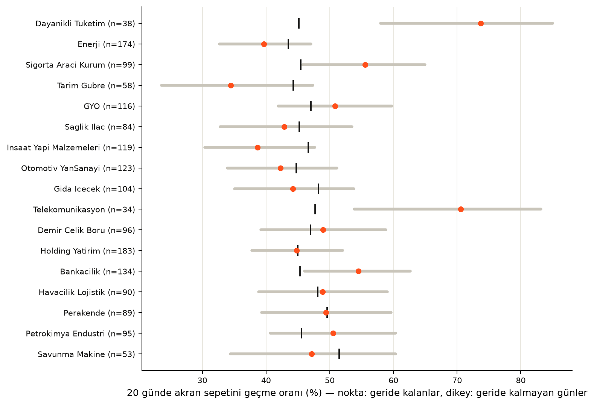

# S1 — Sektörde geride kalma ve yetişme: Perakende

*FinTreX Analyst senaryo raporu · analiz tarihi 10.09.2026 · dönem 01.01.2024 – 10.09.2026. Bu rapor `eval/scenario_reports.py` ile araç çıktılarından üretilmiştir; metindeki ve tablolardaki her sayı bir araç zarfından gelir (kaynak çağrılar ekte). Eğitsel bir analizdir, yatırım tavsiyesi değildir.*

## Ana bulgular

- Perakende sektörünün son 20 işlem günü medyan getirisi +%6,20, XU100 +%1,85: sektör güçlü. Geride kalanlar: MAVI, MGROS; önde olanlar: SOKM.
- Uzun pencerelerde de geride kalan (yapısal aday): MAVI, MGROS.
- 01.01.2024–10.09.2026 arasında 93 geride kalma girişinin 20 günlük yetişme oranı %49,4, geride kalmayan günlerde %49,6; 45 yanlış pozitif.
- 17 sektörün 8 tanesinde geride kalanların 20 günlük yetişme oranı baz orandan yüksek, 3 tanesinde fark istatistiksel olarak anlamlı (p < 0,05).
- `B_TECH_SECTOR` backtest'i +%9,01; XU100'ün 75,29 puan gerisinde.

## 1. Soru

> BIMAS, MGROS ve MAVI için son 20 işlem gününde sektör medyanının gerisinde kalan hisse hangisi? 2024–2026 arasında geride kalanların 5/10/20 günlük kapanma oranları ve yanlış pozitifleri nedir; geride kalma temel/makro nedenlerle mi? POTENTIAL_CATCH_UP_CANDIDATE uygun mu?

Şartname §11: güçlü bir sektörde belirgin biçimde geride kalan hisselerin daha sonra sektörünü yakalayıp
yakalamadığı; geride kalmanın yapısal mı geçici mi olduğu; yanlış pozitifler.

## 2. Yöntem

- **Akran grubu:** TÜBİTAK 95 hisse sektör haritası (`config/universe.yaml: peer_groups`). Soruda adı geçen hisseler
  yerine hissenin bütün sektörü kullanılır (BIMAS, MGROS, SOKM, MAVI).
- **Geride kalma skoru:** hisse getirisi − DİĞER üyelerin medyan getirisi (kendisi hariç).
  Eşik -5,00 puan.
- **Güçlü sektör:** grup medyanı > 0 ve > XU100 (aynı pencerede).
- **Olay:** güçlü sektörde geride kalma durumuna GİRİŞ (her epizotta bir olay; her gün sayılmaz).
- **Yetişme:** sonraki h günde hisse getirisi − diğer üyelerin eşit ağırlıklı sepeti > 0. Tersi = yanlış pozitif.
  Kıyas: geride kalmayan günlerin aynı oranı. İleri penceresi dolmayan olaylar alınmaz.

## 3. Bugünkü sıralama (10.09.2026, son 20 işlem günü)

| Hisse | Getiri | Diğer üyelerin medyanı | Geride kalma skoru | Sıra | XU100'e göre |
| :--- | ---: | ---: | ---: | ---: | ---: |
| SOKM | +%14,88 | -%1,81 | 16,69 puan | 1/4 | 13,03 puan |
| BIMAS | +%14,21 | -%1,81 | 16,02 puan | 2/4 | 12,36 puan |
| MGROS | -%1,81 | +%14,21 | -16,02 puan | 3/4 | -3,66 puan |
| MAVI | -%5,06 | +%14,21 | -19,27 puan | 4/4 | -6,91 puan |

**Farklı pencerelerde geride kalma skoru**

| Hisse | 5g | 10g | 20g | 60g |
| :--- | ---: | ---: | ---: | ---: |
| BIMAS | -0,30 puan | 7,09 puan | 16,02 puan | 25,09 puan |
| MGROS | 0,86 puan | -7,66 puan | -16,02 puan | -32,83 puan |
| SOKM | 0,30 puan | 10,80 puan | 16,69 puan | 37,06 puan |
| MAVI | -2,54 puan | -7,09 puan | -19,27 puan | -25,09 puan |

**Sektör gücü**

| Pencere | Grup medyanı | XU100 | Durum |
| :--- | ---: | ---: | :--- |
| 5g | +%4,33 | +%3,31 | güçlü |
| 10g | +%0,38 | -%1,25 | güçlü |
| 20g | +%6,20 | +%1,85 | güçlü |
| 60g | -%0,13 | -%0,19 | güçlü değil |

## 4. Geride kalanlar tarihsel olarak yetişiyor mu?

| Ufuk | n | Yetişti | Yanlış pozitif | Oran [%95 GA] | Geride kalmayan günler | Medyan göreli | p |
| :--- | ---: | ---: | ---: | ---: | ---: | ---: | ---: |
| 5g | 91 | 39 | 52 | %42,9 [%33–%53] | %48,9 | -0,24 puan | 0,294 |
| 10g | 91 | 46 | 45 | %50,5 [%40–%61] | %49,0 | 0,21 puan | 0,834 |
| 20g | 89 | 44 | 45 | %49,4 [%39–%60] | %49,6 | -0,14 puan | 1,000 |

**Son yanlış pozitifler** (geride kalan hisse sonra da sepetin gerisinde kaldı)

| Tarih | Hisse | Geride kalma | 5g göreli | 10g göreli | 20g göreli |
| :--- | ---: | ---: | ---: | ---: | ---: |
| 03.06.2026 | SOKM | -8,33 puan | -1,34 puan | -1,40 puan | -0,14 puan |
| 16.07.2026 | MAVI | -6,30 puan | -4,61 puan | -4,09 puan | -0,79 puan |
| 16.07.2026 | MGROS | -11,52 puan | -0,49 puan | 1,11 puan | -9,45 puan |
| 20.07.2026 | MGROS | -9,83 puan | -0,24 puan | -0,34 puan | -9,10 puan |
| 27.07.2026 | MGROS | -11,56 puan | -0,12 puan | 5,18 puan | -15,66 puan |
| 31.07.2026 | MAVI | -8,90 puan | -1,57 puan | 1,67 puan | -5,20 puan |
| 06.08.2026 | MGROS | -5,02 puan | -12,28 puan | -15,83 puan | -22,34 puan |
| 10.08.2026 | MAVI | -6,51 puan | 2,57 puan | -4,30 puan | -7,14 puan |

## 5. Yapısal mı, geçici mi?

Uzun pencerelerde de geride kalan hisseler: **MAVI, MGROS**. Son bilançolar
(aynı harness koşusundan, yalnız 10.09.2026 itibarıyla açıklanmış olanlar):

| Hisse | Dönem | Açıklama | FAVÖK marjı | Net kâr marjı | Hasılat (yıllık, YTD) |
| :--- | :--- | :--- | ---: | ---: | ---: |
| BIMAS | 2026Ç2 | 17.08.2026 22:35 | %4,75 → %5,42 | %3,04 → %3,32 | +%9,9 |
| MGROS | 2026Ç2 | 11.08.2026 21:43 | %4,84 → %4,55 | %1,46 → %0,42 | +%4,5 |
| MAVI | 2026Ç1 | 09.06.2026 18:18 | %18,52 → %19,01 | %4,81 → %5,40 | -%1,9 |

Marjları düşen bir hissedeki geride kalma, fiyatın temel bir bozulmayı yansıttığını düşündürür (yapısal aday);
marjları iyileşen bir hissedeki geride kalma geçici olabilir. Bu ayrım kesin değildir; sistem bu yüzden aday etiketini
ancak backtest kanıtıyla verir.

## 6. Bütün sektörler

Aynı çalışma 30 hisselik ders evrenindeki her sektör için tekrarlandı (20 günlük ufuk):

| Sektör | Üye | Olay | Yetişme | Baz | Yanlış pozitif | Medyan göreli | p |
| :--- | ---: | ---: | ---: | ---: | ---: | ---: | ---: |
| Savunma Makine | 2 | 53 | %47,2 | %51,5 | 28 | -2,23 puan | 0,583 |
| Petrokimya Endustri | 5 | 95 | %50,5 | %45,6 | 47 | 0,06 puan | 0,355 |
| Perakende | 4 | 89 | %49,4 | %49,6 | 45 | -0,14 puan | 1,000 |
| Havacilik Lojistik | 5 | 90 | %48,9 | %48,1 | 46 | -0,32 puan | 0,916 |
| Bankacilik | 8 | 134 | %54,5 | %45,3 | 61 | 0,36 puan | 0,037 |
| Holding Yatirim | 10 | 183 | %44,8 | %45,0 | 101 | -1,72 puan | 1,000 |
| Demir Celik Boru | 5 | 96 | %49,0 | %47,0 | 49 | -0,31 puan | 0,759 |
| Telekomunikasyon | 2 | 34 | %70,6 | %47,7 | 10 | 2,09 puan | 0,009 |
| Gida Icecek | 5 | 104 | %44,2 | %48,2 | 58 | -1,25 puan | 0,434 |
| Otomotiv YanSanayi | 10 | 123 | %42,3 | %44,8 | 71 | -0,92 puan | 0,588 |
| Insaat Yapi Malzemeleri | 7 | 119 | %38,7 | %46,6 | 73 | -2,91 puan | 0,098 |
| Saglik Ilac | 4 | 84 | %42,9 | %45,2 | 48 | -1,03 puan | 0,743 |
| GYO | 5 | 116 | %50,9 | %47,0 | 57 | 0,50 puan | 0,457 |
| Tarim Gubre | 3 | 58 | %34,5 | %44,3 | 38 | -2,85 puan | 0,147 |
| Sigorta Araci Kurum | 4 | 99 | %55,6 | %45,5 | 44 | 0,89 puan | 0,055 |
| Enerji | 10 | 174 | %39,7 | %43,5 | 105 | -1,68 puan | 0,321 |
| Dayanikli Tuketim | 3 | 38 | %73,7 | %45,2 | 10 | 3,20 puan | 0,000 |

17 sektörün 8 tanesinde geride kalanların yetişme oranı baz orandan yüksek; 3 tanesinde fark
p < 0,05. Sektör sayısı kadar test yapıldığı için tek tek anlamlı görünen sonuçlar da çoklu test riskini taşır.

## 7. Backtest

`B_TECH_SECTOR` varyantı (Teknik + sektör), önceden sabitlenmiş kural:

| Ölçüt | Değer |
| :--- | ---: |
| Dönem | 02.01.2024 – 10.09.2026 |
| Sinyal / kapanan işlem | 56 / 56 |
| Kazanan oranı | %44,6 |
| Kümülatif getiri (nominal) | +%9,01 |
| Reel getiri (TÜFE) | -%52,74 |
| XU100'e göre fark | -75,29 puan |
| Eşit ağırlıklı al-tut'a göre fark | -93,04 puan |
| Sharpe (rf = 0 / politika faizi) | 0,47 / -4,42 |
| En büyük düşüş | -%8,91 |
| Örneklem içi (02.01.2024 – 31.12.2025) | +%9,27, Sharpe 0,66 |
| Örneklem dışı (02.01.2026 – 10.09.2026) | -%0,24, Sharpe 0,00 |

## 8. Harness kararı

Aynı soru 17 adımlı harness'tan geçirildi (senaryo planlayıcı + kural tabanlı açıklayıcı): **INVESTIGATE**, risk kapısı **PASS_WITH_WARNINGS** (63 bulgu; türler: FILLED_FROM_SECONDARY, MISSING_DAY, SPARSE_NEWS, SPEECH_NOT_AVAILABLE, TMS29_DECUMULATION_APPROX, TMS29_WARNING). 25 araç çağrısı, 0 geçersiz.

Sistemin açıklaması (kanıt numaraları E# ile):

> 10.09.2026 itibarıyla perakende grubunun son 20 işlem günü medyan getirisi +%6,20 (XU100 +%1,85); sektör güçlü (E1). BIMAS son 20 işlem gününde +%14,21 getiri sağladı; diğer üyelerin medyanı -%1,81, fark 16,02 puan (akranlarının önünde); grup içi sıra 2/4 (E2). MGROS son 20 işlem gününde -%1,81 getiri sağladı; diğer üyelerin medyanı +%14,21, fark -16,02 puan (akranlarının gerisinde); grup içi sıra 3/4 (E3). MAVI son 20 işlem gününde -%5,06 getiri sağladı; diğer üyelerin medyanı +%14,21, fark -19,27 puan (akranlarının gerisinde); grup içi sıra 4/4 (E4). Geride kalma uzun pencerelerde de sürüyor (E8, E9); yapısal mı geçici mi olduğu temel/makro kanıtla ayrıştırılmalı. Risk kapısı sonucu PASS_WITH_WARNINGS (E16).
>
> MGROS yalnız son 20 günde değil, daha uzun pencerelerde de akranlarının gerisinde (yapısal geride kalma adayı; temel/makro kanıtla ayrıştırılmalı) (E8). MAVI yalnız son 20 günde değil, daha uzun pencerelerde de akranlarının gerisinde (yapısal geride kalma adayı; temel/makro kanıtla ayrıştırılmalı) (E9). BIMAS için 17.08.2026 baz günlü açıklamanın 20 günlük penceresi 10.09.2026 itibarıyla tamamlanmadı (18 işlem günü var); bu ufuk istatistiğe alınmadı (E13).
>
> Bu çıktı eğitsel bir analizdir; geçmiş sonuçlar gelecekteki getirinin göstergesi değildir ve yatırım tavsiyesi değildir.

## 9. Sınırlar

- Sektör grupları küçük (2–10 üye); medyan birkaç hissenin hareketine duyarlı.
- Geride kalma epizotları bağımsız değildir (aynı sektör, aynı günler); güven aralıkları iyimser olabilir.
- Temel ayrım yalnız son raporların marjlarına bakar; TMS 29 dönemleri arasında karşılaştırma uyarılıdır.

## Ek — kaynak araç çağrıları

Analiz `A-20261127013505226836-4f455401` · karar `D-20261127013505226836-4f455401` · episodik kayıt `reports/scenarios/episodic_q1.sqlite`.

Veri sürümü (sha256, ilk 12): fundamentals `41b26fc0d037`, macro `7c8f1f74f52e`, news `cfba92ab38d9`, prices `330c06c5e4c9`

| Adım | Araç | Kaynak | call_id |
| :--- | :--- | :--- | :--- |
| LOAD_MARKET_DATA | `get_stock_history` | plan | `ab99f0004c8c5d09` |
| LOAD_MARKET_DATA | `get_stock_history` | plan | `2a449975584cd7a2` |
| LOAD_MARKET_DATA | `get_stock_history` | plan | `3986b8d3d6523e5e` |
| LOAD_MARKET_DATA | `get_index_history` | plan | `d27ba4b9d88d0542` |
| CHECK_DATA_QUALITY | `check_data_quality` | harness | `fe50d0ae84e4f39a` |
| CALCULATE_TECHNICALS | `calculate_indicators` | plan | `846c3c6e29b63128` |
| CALCULATE_TECHNICALS | `calculate_indicators` | plan | `2d3634d481fe86e0` |
| CALCULATE_TECHNICALS | `calculate_indicators` | plan | `94f8bc02872df2ca` |
| RUN_SECTOR_RELATIVE_ANALYSIS | `rank_sector_relative_strength` | plan | `d8306d0c5edd6d62` |
| LOAD_FUNDAMENTALS | `calculate_fundamental_change` | plan | `c95efabf74299449` |
| LOAD_FUNDAMENTALS | `calculate_fundamental_change` | plan | `10ebbd7b0b303128` |
| LOAD_FUNDAMENTALS | `calculate_fundamental_change` | plan | `f4b1c1260b41edc9` |
| LOAD_MACRO_CONTEXT | `get_macro_context` | plan | `49fa028967f92c06` |
| LOAD_NEWS_AND_SPEECH_CONTEXT | `get_news_events` | plan | `05367b42cd7e3f6c` |
| LOAD_NEWS_AND_SPEECH_CONTEXT | `get_news_events` | plan | `c7cdbbd2c65b1e60` |
| LOAD_NEWS_AND_SPEECH_CONTEXT | `get_news_events` | plan | `477eee9baf9ce8e7` |
| LOAD_NEWS_AND_SPEECH_CONTEXT | `get_speech_features` | plan | `0a46f2ce927974db` |
| LOAD_NEWS_AND_SPEECH_CONTEXT | `get_speech_features` | plan | `fab83e224ec3021b` |
| LOAD_NEWS_AND_SPEECH_CONTEXT | `get_speech_features` | plan | `82f34b3bdc9ec9c9` |
| BUILD_EVIDENCE | `build_evidence_bundle` | harness | `1b689aaf08946dd4` |
| PREVIEW_STRATEGIES | `run_backtest` | plan | `051745674b918dfc` |
| RUN_BACKTEST | `run_backtest` | plan | `75da08c60301cdb4` |
| RUN_BACKTEST | `build_evidence_bundle` | harness | `80ed82855a8f952d` |
| RISK_GATE | `check_data_quality` | harness | `6ff59fb72fb1136c` |
| RISK_GATE | `build_evidence_bundle` | harness | `2da150fe38ada819` |

**Karşılaştırma için ek araç çağrıları** (harness dışı, aynı snapshot ve as_of)

| Kapsam | Araç | call_id |
| :--- | :--- | :--- |
| Savunma_Makine | `rank_sector_relative_strength` | `73c0e1caedec58c7` |
| Petrokimya_Endustri | `rank_sector_relative_strength` | `4fcceb109adebf52` |
| Perakende | `rank_sector_relative_strength` | `d8306d0c5edd6d62` |
| Havacilik_Lojistik | `rank_sector_relative_strength` | `c92aa160fbe7cc49` |
| Bankacilik | `rank_sector_relative_strength` | `e1f2b5bc31192c04` |
| Holding_Yatirim | `rank_sector_relative_strength` | `a765833684820bc4` |
| Demir_Celik_Boru | `rank_sector_relative_strength` | `2c4f1c03436afc4c` |
| Telekomunikasyon | `rank_sector_relative_strength` | `5c6408941d6f0392` |
| Gida_Icecek | `rank_sector_relative_strength` | `692117fb66963ce3` |
| Otomotiv_YanSanayi | `rank_sector_relative_strength` | `b22e4aacca36bfcf` |
| Insaat_Yapi_Malzemeleri | `rank_sector_relative_strength` | `862a49dcc47bdfd7` |
| Saglik_Ilac | `rank_sector_relative_strength` | `6bdf66f9bdb38b67` |
| GYO | `rank_sector_relative_strength` | `1dfd1ca5cc6cc425` |
| Tarim_Gubre | `rank_sector_relative_strength` | `6e1830eefe3cec4e` |
| Sigorta_Araci_Kurum | `rank_sector_relative_strength` | `b03357e09679a8e6` |
| Enerji | `rank_sector_relative_strength` | `37a67dce35503c2e` |
| Dayanikli_Tuketim | `rank_sector_relative_strength` | `79a5b6b04831a762` |
