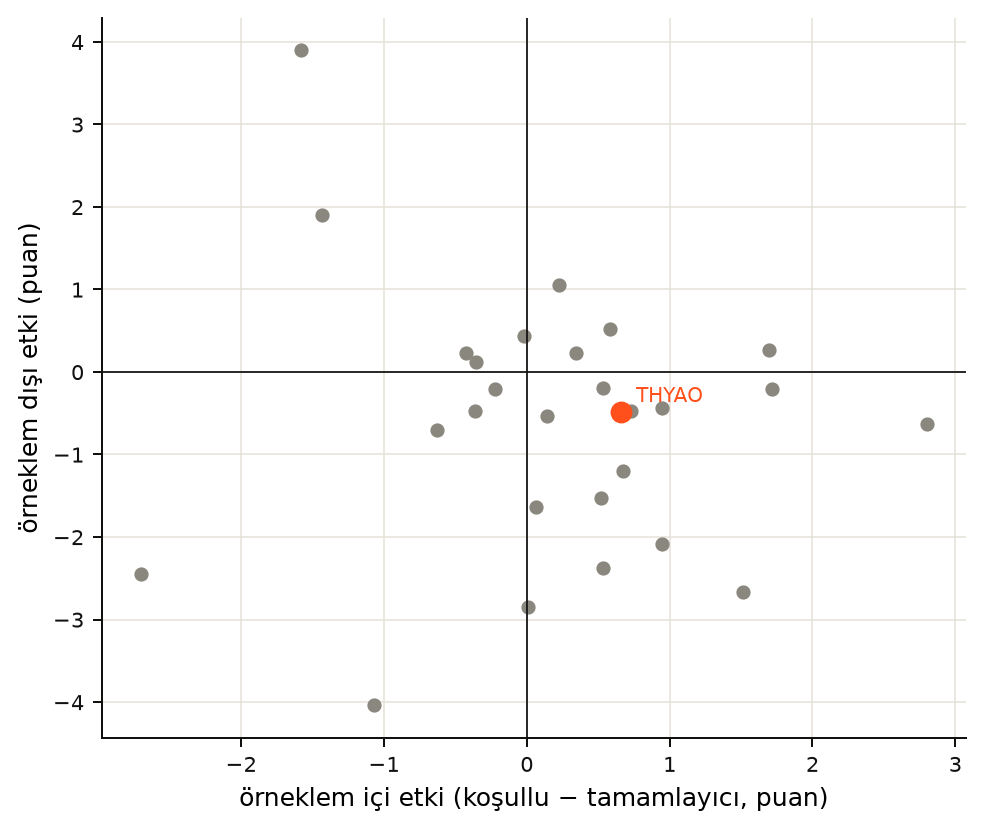

# S2 — Haftanın günü ve çok günlü örüntüler: THYAO

*FinTreX Analyst senaryo raporu · analiz tarihi 10.09.2026 · dönem 01.01.2024 – 10.09.2026. Bu rapor `eval/scenario_reports.py` ile araç çıktılarından üretilmiştir; metindeki ve tablolardaki her sayı bir araç zarfından gelir (kaynak çağrılar ekte). Eğitsel bir analizdir, yatırım tavsiyesi değildir.*

## Ana bulgular

- Koşul ([Pzt düşüş, Sal düşüş, Çar düşüş] → Per-Cum getirisi) örneklem içinde 19 hafta gerçekleşti; sonraki Perşembe–Cuma ortalaması +%1,36 (maliyet sonrası +%1,26), koşulsuz haftalarda +%0,70.
- Çoklu test düzeltmesi sonrası örneklem içi anlamlılık: yok (p (BH) = 0,459, aile büyüklüğü 8).
- Örneklem dışında koşul yalnız 3 hafta oluştu; etki -0,49 puan (ters yönde); örneklem yetersiz.
- Aynı örüntü 30 hissede sınandığında 2 hissede örneklem içi ham p < 0,05, BH sonrası 0; ham anlamlıların 0 tanesi örneklem dışında aynı yönde kaldı.

## 1. Soru

> THYAO'da Pazartesi-Salı-Çarşamba düşüşünden sonra Perşembe-Cuma yükselişi örüntüsü 2024–2025 (örneklem içi) ile 2026-01-01–2026-09-10 (örneklem dışı) arasında tutarlı mı? İşlem maliyeti, koşulsuz getiri ve çoklu test riski dahil.

Şartname §12: bir hissede haftanın günlerine ya da çok günlü dizilere bağlı tekrar eden bir örüntü var mı; örüntü
sonraki görülmemiş dönemde sürüyor mu; işlem maliyeti, koşulsuz getiri ve çoklu test riski.

## 2. Yöntem

- **Koşul ≠ sonuç.** Koşul günleri (Pzt-Sal-Çar düşüş) sonucu içermez; sonuç (Per-Cum bileşik getirisi) koşuldan sonra
  gelen günlerdir (sonuç günleri her koşul gününden sonra gelir).
  Hocanın betiğinde koşul `Thu>0 & Fri>0` içerdiğinden "Per-Cum pozitif oranı" tanım gereği %100 çıkar; burada sonuç
  koşulsuz Per-Cum dağılımıyla kıyaslanır.
- **Dönemler bütün haftalarla.** Ayrımı kesen ya da analiz tarihinde yarım kalan hafta hiçbir döneme girmez.
- **Kıyaslar:** koşulsuz haftalar, koşulun gerçekleşmediği haftalar (tamamlayıcı); Welch, binom, permütasyon testleri ve
  bootstrap güven aralığı. İşlem maliyeti 10 baz puan.
- **Çoklu test ailesi:** koşul günlerinin tüm işaret kombinasyonları (8 örüntü);
  Bonferroni ve Benjamini–Hochberg.

## 3. Örüntü: [Pzt düşüş, Sal düşüş, Çar düşüş] → Per-Cum getirisi

Ortalama / medyan Per-Cum bileşik getirisi; olumlu oran.

| Dönem | Tarihler | Tam hafta | Koşul haftası | Sıklık | Koşullu ort. / medyan | Maliyet sonrası | Pozitif oran | Koşulsuz ort. / pozitif | Tamamlayıcı ort. |
| :--- | ---: | ---: | ---: | ---: | ---: | ---: | ---: | ---: | ---: |
| Örneklem içi | 01.01.2024 – 31.12.2025 | 87 | 19 | %21,8 | +%1,36 / +%0,78 | +%1,26 | %73,7 | +%0,70 / %56,3 | +%0,52 |
| Örneklem dışı | 01.01.2026 – 10.09.2026 | 29 | 3 | %10,3 | +%0,13 / +%0,16 | +%0,03 | %66,7 | +%0,62 / %58,6 | +%0,67 |

**İstatistiksel testler**

| Dönem | Fark (koşullu − tamamlayıcı) | p Welch | p binom | p permütasyon | Bootstrap %95 GA | Ailede sıra | p (BH) | Tam 5 günlük dizi |
| :--- | ---: | ---: | ---: | ---: | ---: | ---: | ---: | ---: |
| Örneklem içi | 0,66 puan | 0,263 | 0,166 | 0,170 | +%0,07 – +%2,67 | 3/8 | 0,459 | 6 (%6,9) |
| Örneklem dışı | -0,49 puan | 0,601 | 1,000 | 0,693 | -%1,32 – +%1,54 | 6/8 | 0,695 | 0 (%0,0) |

**Kararlılık:** örneklem içi etki 0,66 puan, örneklem dışı
-0,49 puan; aynı yön: hayır;
örneklem dışı yeterli: hayır; düzeltme sonrası anlamlı:
hayır; maliyet sonrası pozitif (örneklem içi):
evet.

**Koşulun gerçekleştiği haftalar (örneklem içi)**

| Hafta | Pzt | Sal | Çar | Per | Cum | Per-Cum |
| :--- | ---: | ---: | ---: | ---: | ---: | ---: |
| 26.02.2024 | -%0,35 | -%1,84 | -%1,52 | +%2,08 | -%1,42 | +%0,63 |
| 04.03.2024 | -%2,61 | -%1,94 | -%1,60 | +%4,50 | +%2,38 | +%6,99 |
| 25.03.2024 | -%1,89 | -%0,18 | -%0,88 | +%5,30 | %0,00 | +%5,30 |
| 15.04.2024 | -%3,48 | -%0,50 | -%0,59 | +%0,34 | +%2,11 | +%2,46 |
| 13.05.2024 | -%1,18 | -%1,27 | -%1,53 | +%0,49 | +%5,37 | +%5,89 |
| 27.05.2024 | -%1,02 | -%0,95 | -%1,92 | %0,00 | -%1,06 | -%1,06 |
| 24.06.2024 | -%1,82 | -%1,45 | -%1,55 | +%1,58 | +%0,98 | +%2,57 |
| 22.07.2024 | -%1,82 | -%1,21 | -%0,33 | -%1,56 | +%0,42 | -%1,15 |
| 29.07.2024 | -%2,49 | -%0,17 | -%1,45 | +%2,85 | -%2,02 | +%0,78 |
| 12.08.2024 | -%0,50 | -%0,83 | -%2,02 | -%1,11 | +%1,73 | +%0,60 |
| 09.09.2024 | -%1,45 | -%1,73 | -%1,41 | +%2,23 | +%2,10 | +%4,38 |
| 30.09.2024 | -%2,48 | -%2,54 | -%2,25 | -%1,01 | +%1,86 | +%0,83 |
| 11.11.2024 | -%0,78 | -%0,52 | -%0,96 | +%0,97 | +%1,13 | +%2,11 |
| 18.11.2024 | -%0,35 | -%3,38 | -%2,87 | +%3,23 | -%0,09 | +%3,14 |
| 06.01.2025 | -%0,34 | -%1,18 | -%0,17 | +%0,60 | -%0,42 | +%0,17 |
| 10.02.2025 | -%0,62 | -%0,23 | -%0,78 | +%0,71 | -%0,78 | -%0,08 |
| 17.03.2025 | -%0,89 | -%2,10 | -%7,87 | +%2,24 | -%7,22 | -%5,15 |
| 13.10.2025 | -%1,51 | -%2,27 | -%0,41 | -%1,58 | -%1,35 | -%2,91 |
| 10.11.2025 | -%3,89 | -%1,89 | -%1,83 | +%1,12 | -%0,74 | +%0,37 |

## 4. Haftanın günleri

Ortalama günlük getiri / pozitif gün oranı ve BH düzeltilmiş p (ortalama = 0 testi).

| Gün | Örneklem içi | p (BH) | Örneklem dışı | p (BH) |
| :--- | ---: | ---: | ---: | ---: |
| Pazartesi | -%0,04 / %43 | 0,848 | -%0,12 / %39 | 0,741 |
| Salı | -%0,07 / %42 | 0,848 | +%0,22 / %46 | 0,741 |
| Çarşamba | -%0,30 / %43 | 0,249 | -%0,16 / %44 | 0,741 |
| Perşembe | +%0,40 / %57 | 0,081 | -%0,13 / %47 | 0,741 |
| Cuma | +%0,27 / %53 | 0,249 | +%0,64 / %58 | 0,281 |

Günler arası fark testi: örneklem içi ANOVA p = 0,067, Kruskal–Wallis p =
0,012; örneklem dışı ANOVA p = 0,449,
Kruskal–Wallis p = 0,464.

## 5. Diğer örüntüler ve piyasa yönüne göre

| Örüntü | Koşul | İçi hafta | İçi maliyet sonrası | İçi p (BH) | Dışı hafta | Dışı maliyet sonrası | Aynı yön |
| :--- | :--- | ---: | ---: | ---: | ---: | ---: | :--- |
| [Pzt düşüş, Sal düşüş, Çar düşüş] → Per-Cum getirisi | tüm haftalar | 19 | +%1,26 | 0,459 | 3 | +%0,03 | hayır |
| [Pzt düşüş, Sal düşüş, Çar düşüş] → Per-Cum getirisi | XU100 yükselen hafta | 1 | +%2,01 | – | 0 | – | hayır |
| [Pzt düşüş, Sal düşüş, Çar düşüş] → Per-Cum getirisi | XU100 düşen hafta | 18 | +%1,22 | 0,669 | 3 | +%0,03 | hayır |
| [Pzt düşüş] → Cum getirisi | tüm haftalar | 46 | +%0,07 | 0,760 | 15 | -%0,29 | evet |
| [Pzt yükseliş, Sal yükseliş, Çar yükseliş, Per yükseliş] → Cum getirisi | tüm haftalar | 5 | +%1,09 | 0,792 | 1 | -%1,12 | hayır |

## 6. Aynı örüntü bütün hisselerde

Şartname "ikinci bir hisse ters örüntü gösterebilir" diyor. Aynı örüntü ders evrenindeki 30 hissede sınandı:
2 hissede örneklem içi ham p < 0,05, Benjamini–Hochberg sonrası 0. Örneklem dışında
9/30 hissede etki aynı yönde kaldı; ham anlamlı olanların 0 tanesi aynı yönde.
Yeterince çok hisse ve örüntü denendiğinde şans eseri "anlamlı" sonuçlar çıkar; örneklem dışı tutarlılık olmadan
bunlar işlem kuralına dönüştürülmemelidir.

## 7. Backtest

`A_TECH` varyantı (Teknik), önceden sabitlenmiş kural:

| Ölçüt | Değer |
| :--- | ---: |
| Dönem | 02.01.2024 – 10.09.2026 |
| Sinyal / kapanan işlem | 25 / 25 |
| Kazanan oranı | %52,0 |
| Kümülatif getiri (nominal) | -%0,31 |
| Reel getiri (TÜFE) | -%56,78 |
| XU100'e göre fark | -84,61 puan |
| Eşit ağırlıklı al-tut'a göre fark | -29,89 puan |
| Sharpe (rf = 0 / politika faizi) | 0,05 / -3,24 |
| En büyük düşüş | -%18,59 |
| Örneklem içi (02.01.2024 – 31.12.2025) | +%15,51, Sharpe 0,72 |
| Örneklem dışı (02.01.2026 – 10.09.2026) | -%13,70, Sharpe -1,88 |

## 8. Harness kararı

Aynı soru 17 adımlı harness'tan geçirildi (senaryo planlayıcı + kural tabanlı açıklayıcı): **REJECT_SIGNAL**, risk kapısı **INVESTIGATE** (3 bulgu; türler: INSUFFICIENT_SAMPLE, MISSING_DAY, SMALL_SAMPLE). 9 araç çağrısı, 0 geçersiz.

Sistemin açıklaması (kanıt numaraları E# ile):

> THYAO [Pzt düşüş, Sal düşüş, Çar düşüş] → Per-Cum getirisi: örneklem içi (01.01.2024–31.12.2025) 87 tam haftanın 19 tanesinde koşul oluştu; bu haftalarda sonuç ortalaması +%1,36, medyanı +%0,78, pozitif oranı %73,68 (tüm haftalarda ortalama +%0,70); 10 baz puan maliyet sonrası +%1,26; 8 örüntülük ailede düzeltilmiş p=0,459 (E1). THYAO [Pzt düşüş, Sal düşüş, Çar düşüş] → Per-Cum getirisi: örneklem dışı (01.01.2026–10.09.2026) 29 tam haftanın 3 tanesinde koşul oluştu; bu haftalarda sonuç ortalaması +%0,13, medyanı +%0,16, pozitif oranı %66,67 (tüm haftalarda ortalama +%0,62); 10 baz puan maliyet sonrası +%0,03; 8 örüntülük ailede düzeltilmiş p=0,695 (E2). Koşullu-koşulsuz fark örneklem içinde 0,66 puan, örneklem dışında -0,49 puan; işaret ters; örneklem dışı koşul sayısı 3 (yetersiz örneklem) (E3). örneklem içi dönemde tam haftalık dizi (koşul + sonuç günleri beklenen yönde) 6 kez görüldü (tam haftaların %6,90'i); bu betimsel bir sıklıktır, test değildir (E4). Haftanın günü örüntüsü istatistiksel olarak kararlı değil: çoklu test düzeltmesi sonrası örneklem içi kanıt zayıf (E1) ve örneklem dışı sonuç yetersiz ya da ters yönde (E3). Risk kapısı sonucu INVESTIGATE (E7).
>
> Sonuçlar geçmiş veriye dayanır; korelasyon nedensellik değildir.
>
> Bu çıktı eğitsel bir analizdir; geçmiş sonuçlar gelecekteki getirinin göstergesi değildir ve yatırım tavsiyesi değildir.

## 9. Sınırlar

- Örneklem dışı dönem kısa (29 tam hafta); koşul haftası sayısı az.
- Bayram ve yarım günler haftaları eksik bırakır; bu haftalar hiçbir döneme alınmaz.
- Örüntü ailesi koşul işaretleriyle sınırlı; daha geniş bir arama çoklu test riskini artırır.

## Ek — kaynak araç çağrıları

Analiz `A-20261127013515521742-db645782` · karar `D-20261127013515521742-db645782` · episodik kayıt `reports/scenarios/episodic_q2.sqlite`.

Veri sürümü (sha256, ilk 12): fundamentals `41b26fc0d037`, macro `7c8f1f74f52e`, news `cfba92ab38d9`, prices `330c06c5e4c9`

| Adım | Araç | Kaynak | call_id |
| :--- | :--- | :--- | :--- |
| LOAD_MARKET_DATA | `get_stock_history` | plan | `0a344bf789c9dbed` |
| LOAD_MARKET_DATA | `get_index_history` | plan | `d27ba4b9d88d0542` |
| CHECK_DATA_QUALITY | `check_data_quality` | harness | `6a3482ff8247ba89` |
| RUN_PATTERN_AND_REVERSAL_ANALYSIS | `test_weekday_pattern` | plan | `f869c4d2b5139cf3` |
| BUILD_EVIDENCE | `build_evidence_bundle` | harness | `0a006e233cf9ff63` |
| RUN_BACKTEST | `run_backtest` | plan | `f02e4eca4a9751f3` |
| RUN_BACKTEST | `build_evidence_bundle` | harness | `145917c09ad18b6a` |
| RISK_GATE | `check_data_quality` | harness | `cc16a4c22402fc53` |
| RISK_GATE | `build_evidence_bundle` | harness | `b60460efe2b97ae2` |

**Karşılaştırma için ek araç çağrıları** (harness dışı, aynı snapshot ve as_of)

| Kapsam | Araç | call_id |
| :--- | :--- | :--- |
| THYAO MON_TUE_WED_DOWN__THU_FRI tüm haftalar | `test_weekday_pattern` | `f869c4d2b5139cf3` |
| THYAO MON_TUE_WED_DOWN__THU_FRI XU100 yükselen hafta | `test_weekday_pattern` | `d0c904012a551033` |
| THYAO MON_TUE_WED_DOWN__THU_FRI XU100 düşen hafta | `test_weekday_pattern` | `781014a131e2aa04` |
| THYAO MON_DOWN__FRI tüm haftalar | `test_weekday_pattern` | `3b49dc0acd1009f1` |
| THYAO MON_TO_THU_UP__FRI tüm haftalar | `test_weekday_pattern` | `19fb35e805c491f4` |
| ASELS MON_TUE_WED_DOWN__THU_FRI | `test_weekday_pattern` | `1c276172539f15a9` |
| TUPRS MON_TUE_WED_DOWN__THU_FRI | `test_weekday_pattern` | `bf44768fda2c6dc3` |
| BIMAS MON_TUE_WED_DOWN__THU_FRI | `test_weekday_pattern` | `eebdd2a98f85a4a9` |
| THYAO MON_TUE_WED_DOWN__THU_FRI | `test_weekday_pattern` | `f869c4d2b5139cf3` |
| AKBNK MON_TUE_WED_DOWN__THU_FRI | `test_weekday_pattern` | `f2e51c54fa7f67d9` |
| KCHOL MON_TUE_WED_DOWN__THU_FRI | `test_weekday_pattern` | `fdbc5a23df93a356` |
| EREGL MON_TUE_WED_DOWN__THU_FRI | `test_weekday_pattern` | `4fdf2bfac671816e` |
| TCELL MON_TUE_WED_DOWN__THU_FRI | `test_weekday_pattern` | `65687ac6faf8c426` |
| CCOLA MON_TUE_WED_DOWN__THU_FRI | `test_weekday_pattern` | `213f726083a5b955` |
| MGROS MON_TUE_WED_DOWN__THU_FRI | `test_weekday_pattern` | `af5723059561ab16` |
| SASA MON_TUE_WED_DOWN__THU_FRI | `test_weekday_pattern` | `3db34ba0657593cd` |
| TRALT MON_TUE_WED_DOWN__THU_FRI | `test_weekday_pattern` | `cd3cc8d879d9155f` |
| FROTO MON_TUE_WED_DOWN__THU_FRI | `test_weekday_pattern` | `bf5d5a6a722421d8` |
| ENKAI MON_TUE_WED_DOWN__THU_FRI | `test_weekday_pattern` | `346bb672a844fcfe` |
| PGSUS MON_TUE_WED_DOWN__THU_FRI | `test_weekday_pattern` | `da13a7102ca50add` |
| MPARK MON_TUE_WED_DOWN__THU_FRI | `test_weekday_pattern` | `2247d34a4f9d7325` |
| EKGYO MON_TUE_WED_DOWN__THU_FRI | `test_weekday_pattern` | `a2ae374c016aa4da` |
| GUBRF MON_TUE_WED_DOWN__THU_FRI | `test_weekday_pattern` | `82830de79f8c193a` |
| TURSG MON_TUE_WED_DOWN__THU_FRI | `test_weekday_pattern` | `417f2144cf2f1e86` |
| ENJSA MON_TUE_WED_DOWN__THU_FRI | `test_weekday_pattern` | `714d8c75b1a00120` |
| TTKOM MON_TUE_WED_DOWN__THU_FRI | `test_weekday_pattern` | `084df0802ecf876a` |
| OYAKC MON_TUE_WED_DOWN__THU_FRI | `test_weekday_pattern` | `ae70b1d03ed1e98b` |
| AKSEN MON_TUE_WED_DOWN__THU_FRI | `test_weekday_pattern` | `b0de8b084d7bbb83` |
| ISMEN MON_TUE_WED_DOWN__THU_FRI | `test_weekday_pattern` | `5f227c140d5c69ec` |
| ARCLK MON_TUE_WED_DOWN__THU_FRI | `test_weekday_pattern` | `27ba2dafbbc0409d` |
| ECILC MON_TUE_WED_DOWN__THU_FRI | `test_weekday_pattern` | `c099a9cc7abbc3ea` |
| MAVI MON_TUE_WED_DOWN__THU_FRI | `test_weekday_pattern` | `77923783a7336a3a` |
| PETKM MON_TUE_WED_DOWN__THU_FRI | `test_weekday_pattern` | `4e407313f4ad4559` |
| TOASO MON_TUE_WED_DOWN__THU_FRI | `test_weekday_pattern` | `e096005b86afa856` |
| KRDMD MON_TUE_WED_DOWN__THU_FRI | `test_weekday_pattern` | `c6f3aca3591723d6` |
