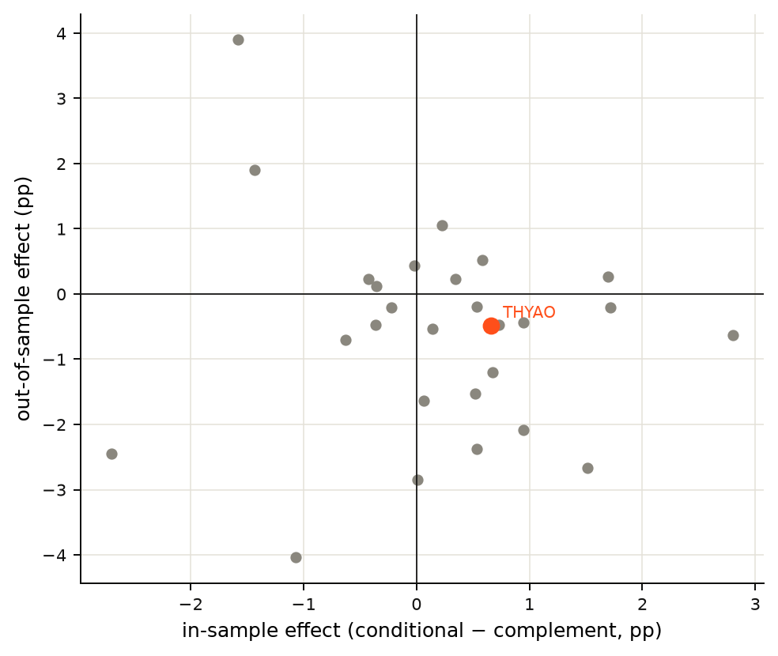

# S2 — Weekday and multi-day patterns: THYAO

*FinTreX Analyst research report · analysis date (as_of) 2026-09-10 · period 2024-01-01 to 2026-09-10. Generated by `eval/scenario_reports.py` from tool outputs: every number in the text and tables comes from a tool envelope (source calls in the appendix). Educational analysis, not investment advice.*

## Key findings

- The condition [Mon down, Tue down, Wed down] → Thu–Fri return occurred in 19 in-sample weeks; the following Thursday–Friday averaged +1.36% (+1.26% after costs) versus +0.70% in all weeks.
- Significant in sample after multiple-testing correction: no (p (BH) = 0.459, family size 8).
- Out of sample the condition occurred in only 3 weeks; the effect was -0.49 pp (opposite sign); the sample is insufficient.
- Tested on 30 stocks, the same pattern has raw in-sample p < 0.05 in 2 and 0 after Benjamini–Hochberg; 0 of the raw-significant ones keep the same sign out of sample.

## 1. Question

> Is the pattern 'Monday-Tuesday-Wednesday decline followed by a Thursday-Friday rise' in THYAO consistent between 2024-2025 (in sample) and 2026-01-01 to 2026-09-10 (out of sample)? Include transaction costs, the unconditional return and multiple-testing risk.

*(Instructor's golden question Q2; the original Turkish wording is in `eval/golden_questions.json`.)*

Specification §12: does a stock show a recurring day-of-week or multi-day sequence; does the pattern survive a later unseen period; transaction costs, unconditional returns and multiple-testing risk.

## 2. Method

- **Condition ≠ outcome.** The condition days (Mon-Tue-Wed down) never contain the outcome; the outcome (compound
  Thu–Fri return) comes after every condition day. The instructor's script includes `Thu>0 & Fri>0` in the condition,
  so its "Thu-Fri positive rate" is 100% by construction; here the outcome is compared with the unconditional
  Thu–Fri distribution.
- **Periods are whole weeks.** A week cut by the split or unfinished at the analysis date belongs to no period.
- **Comparisons:** all weeks (unconditional) and the weeks without the condition (complement); Welch, binomial and
  permutation tests and a bootstrap confidence interval. Transaction cost 10 bp.
- **Multiple-testing family:** all sign combinations of the condition days (8 patterns);
  Bonferroni and Benjamini–Hochberg.

## 3. Pattern: [Mon down, Tue down, Wed down] → Thu–Fri return

Mean / median compound Thu–Fri return and positive rate.

| Period | Dates | Complete weeks | Condition weeks | Frequency | Conditional mean / median | After cost | Positive rate | Unconditional mean / positive | Complement mean |
| :--- | ---: | ---: | ---: | ---: | ---: | ---: | ---: | ---: | ---: |
| In sample | 2024-01-01 to 2025-12-31 | 87 | 19 | 21.8% | +1.36% / +0.78% | +1.26% | 73.7% | +0.70% / 56.3% | +0.52% |
| Out of sample | 2026-01-01 to 2026-09-10 | 29 | 3 | 10.3% | +0.13% / +0.16% | +0.03% | 66.7% | +0.62% / 58.6% | +0.67% |

**Statistical tests**

| Period | Difference (cond. − complement) | p Welch | p binomial | p permutation | Bootstrap 95% CI | Rank in family | p (BH) | Full 5-day sequence |
| :--- | ---: | ---: | ---: | ---: | ---: | ---: | ---: | ---: |
| In sample | +0.66 pp | 0.263 | 0.166 | 0.170 | +0.07% to +2.67% | 3/8 | 0.459 | 6 (6.9%) |
| Out of sample | -0.49 pp | 0.601 | 1.000 | 0.693 | -1.32% to +1.54% | 6/8 | 0.695 | 0 (0.0%) |

**Stability:** in-sample effect +0.66 pp, out-of-sample -0.49 pp; same sign:
no; out-of-sample sample sufficient: no;
significant after correction: no; positive after costs in
sample: yes.

**Weeks in which the condition occurred (in sample)**

| Week of | Mon | Tue | Wed | Thu | Fri | Thu–Fri |
| :--- | ---: | ---: | ---: | ---: | ---: | ---: |
| 2024-02-26 | -0.35% | -1.84% | -1.52% | +2.08% | -1.42% | +0.63% |
| 2024-03-04 | -2.61% | -1.94% | -1.60% | +4.50% | +2.38% | +6.99% |
| 2024-03-25 | -1.89% | -0.18% | -0.88% | +5.30% | +0.00% | +5.30% |
| 2024-04-15 | -3.48% | -0.50% | -0.59% | +0.34% | +2.11% | +2.46% |
| 2024-05-13 | -1.18% | -1.27% | -1.53% | +0.49% | +5.37% | +5.89% |
| 2024-05-27 | -1.02% | -0.95% | -1.92% | +0.00% | -1.06% | -1.06% |
| 2024-06-24 | -1.82% | -1.45% | -1.55% | +1.58% | +0.98% | +2.57% |
| 2024-07-22 | -1.82% | -1.21% | -0.33% | -1.56% | +0.42% | -1.15% |
| 2024-07-29 | -2.49% | -0.17% | -1.45% | +2.85% | -2.02% | +0.78% |
| 2024-08-12 | -0.50% | -0.83% | -2.02% | -1.11% | +1.73% | +0.60% |
| 2024-09-09 | -1.45% | -1.73% | -1.41% | +2.23% | +2.10% | +4.38% |
| 2024-09-30 | -2.48% | -2.54% | -2.25% | -1.01% | +1.86% | +0.83% |
| 2024-11-11 | -0.78% | -0.52% | -0.96% | +0.97% | +1.13% | +2.11% |
| 2024-11-18 | -0.35% | -3.38% | -2.87% | +3.23% | -0.09% | +3.14% |
| 2025-01-06 | -0.34% | -1.18% | -0.17% | +0.60% | -0.42% | +0.17% |
| 2025-02-10 | -0.62% | -0.23% | -0.78% | +0.71% | -0.78% | -0.08% |
| 2025-03-17 | -0.89% | -2.10% | -7.87% | +2.24% | -7.22% | -5.15% |
| 2025-10-13 | -1.51% | -2.27% | -0.41% | -1.58% | -1.35% | -2.91% |
| 2025-11-10 | -3.89% | -1.89% | -1.83% | +1.12% | -0.74% | +0.37% |

## 4. Days of the week

Mean daily return / share of positive days and Benjamini–Hochberg p (test of mean = 0).

| Day | In sample | p (BH) | Out of sample | p (BH) |
| :--- | ---: | ---: | ---: | ---: |
| Monday | -0.04% / 43% | 0.848 | -0.12% / 39% | 0.741 |
| Tuesday | -0.07% / 42% | 0.848 | +0.22% / 46% | 0.741 |
| Wednesday | -0.30% / 43% | 0.249 | -0.16% / 44% | 0.741 |
| Thursday | +0.40% / 57% | 0.081 | -0.13% / 47% | 0.741 |
| Friday | +0.27% / 53% | 0.249 | +0.64% / 58% | 0.281 |

Difference across days: in sample ANOVA p = 0.067, Kruskal–Wallis
p = 0.012; out of sample ANOVA p = 0.449, Kruskal–Wallis
p = 0.464.

## 5. Other patterns and conditioning on the market

| Pattern | Weeks | In: weeks | In: after cost | In: p (BH) | Out: weeks | Out: after cost | Same sign |
| :--- | :--- | ---: | ---: | ---: | ---: | ---: | :--- |
| [Mon down, Tue down, Wed down] → Thu–Fri return | all weeks | 19 | +1.26% | 0.459 | 3 | +0.03% | no |
| [Mon down, Tue down, Wed down] → Thu–Fri return | XU100 up weeks | 1 | +2.01% | – | 0 | – | no |
| [Mon down, Tue down, Wed down] → Thu–Fri return | XU100 down weeks | 18 | +1.22% | 0.669 | 3 | +0.03% | no |
| [Mon down] → Fri return | all weeks | 46 | +0.07% | 0.760 | 15 | -0.29% | yes |
| [Mon up, Tue up, Wed up, Thu up] → Fri return | all weeks | 5 | +1.09% | 0.792 | 1 | -1.12% | no |

## 6. The same pattern in every stock

The specification notes that "a second stock may show the opposite pattern". The same pattern was tested in 30
stocks of the course universe: 2 have raw in-sample p < 0.05 and 0 after Benjamini–Hochberg. Out of
sample 9/30 stocks keep the in-sample sign, and 0 of the raw-significant ones do. When
enough stocks and patterns are tried, "significant" results appear by chance; without out-of-sample consistency they
should not become trading rules.

## 7. Backtest

Variant `A_TECH` (technical) of the pre-registered rule `REVERSAL_PRESET_V1` (fixed before any result was seen): entry events `BB_LOWER_REVERSAL`, `RSI_TROUGH_VOLUME`, `SUPERTREND_BULLISH_FLIP`, `SUPPORT_TOUCH`; holding period 2 trading days; signal at the close of day t, trade at the open of t+1; cost 10 bp per trade.

| Measure | Value |
| :--- | ---: |
| Period | 2024-01-02 to 2026-09-10 |
| Signals / closed trades | 25 / 25 |
| Win rate | 52.0% |
| Cumulative return (nominal) | -0.31% |
| Real return (CPI-deflated) | -56.78% |
| Difference vs XU100 | -84.61 pp |
| Difference vs equal-weight buy & hold | -29.89 pp |
| Sharpe (rf = 0 / policy rate) | 0.05 / -3.24 |
| Maximum drawdown | -18.59% |
| In sample (2024-01-02 to 2025-12-31) | +15.51%, Sharpe 0.72 |
| Out of sample (2026-01-02 to 2026-09-10) | -13.70%, Sharpe -1.88 |

## 8. Harness decision

The same question was run through the 17-state harness (scenario planner + rule-based explainer). Final analytical state: **REJECT_SIGNAL**; risk gate **INVESTIGATE** (3 findings; types: INSUFFICIENT_SAMPLE, MISSING_DAY, SMALL_SAMPLE). 9 tool calls, 0 invalid. The explanation cites 5 committed evidence items (E1, E2, E3, E4, E7) and passed the output validator on the first attempt. The product writes its explanation in Turkish; it is stored verbatim in the episodic record above and can be replayed byte for byte.

## 9. Limitations

- The out-of-sample period is short (29 complete weeks) with few condition weeks.
- Holidays and half days leave weeks incomplete; such weeks are excluded from both periods.
- The pattern family is limited to the condition's sign combinations; a wider search raises multiple-testing risk.

## Appendix — source tool calls

Analysis `A-20261127222523685960-db645782` · decision `D-20261127222523685960-db645782` · episodic record `reports/scenarios/episodic_q2.sqlite` (replay: `python -m bistharness.harness replay --decision ...` with that memory file, or the web UI).

Data version (sha256, first 12): fundamentals `41b26fc0d037`, macro `7c8f1f74f52e`, news `cfba92ab38d9`, prices `330c06c5e4c9`

| State | Tool | Origin | call_id |
| :--- | :--- | :--- | :--- |
| LOAD_MARKET_DATA | `get_stock_history` | plan | `0a344bf789c9dbed` |
| LOAD_MARKET_DATA | `get_index_history` | plan | `d27ba4b9d88d0542` |
| CHECK_DATA_QUALITY | `check_data_quality` | harness | `6a3482ff8247ba89` |
| RUN_PATTERN_AND_REVERSAL_ANALYSIS | `test_weekday_pattern` | plan | `f869c4d2b5139cf3` |
| BUILD_EVIDENCE | `build_evidence_bundle` | harness | `24ac52ae6df81246` |
| RUN_BACKTEST | `run_backtest` | plan | `f02e4eca4a9751f3` |
| RUN_BACKTEST | `build_evidence_bundle` | harness | `e1ecb14079ca1adf` |
| RISK_GATE | `check_data_quality` | harness | `cc16a4c22402fc53` |
| RISK_GATE | `build_evidence_bundle` | harness | `241cd71054997d4e` |

**Additional tool calls for comparison** (outside the harness run; same snapshot and as_of)

| Scope | Tool | call_id |
| :--- | :--- | :--- |
| THYAO MON_TUE_WED_DOWN__THU_FRI (all weeks) | `test_weekday_pattern` | `f869c4d2b5139cf3` |
| THYAO MON_TUE_WED_DOWN__THU_FRI (XU100 up weeks) | `test_weekday_pattern` | `d0c904012a551033` |
| THYAO MON_TUE_WED_DOWN__THU_FRI (XU100 down weeks) | `test_weekday_pattern` | `781014a131e2aa04` |
| THYAO MON_DOWN__FRI (all weeks) | `test_weekday_pattern` | `3b49dc0acd1009f1` |
| THYAO MON_TO_THU_UP__FRI (all weeks) | `test_weekday_pattern` | `19fb35e805c491f4` |
| ASELS MON_TUE_WED_DOWN__THU_FRI | `test_weekday_pattern` | `1c276172539f15a9` |
| TUPRS MON_TUE_WED_DOWN__THU_FRI | `test_weekday_pattern` | `bf44768fda2c6dc3` |
| BIMAS MON_TUE_WED_DOWN__THU_FRI | `test_weekday_pattern` | `eebdd2a98f85a4a9` |
| THYAO MON_TUE_WED_DOWN__THU_FRI | `test_weekday_pattern` | `f869c4d2b5139cf3` |
| AKBNK MON_TUE_WED_DOWN__THU_FRI | `test_weekday_pattern` | `f2e51c54fa7f67d9` |
| KCHOL MON_TUE_WED_DOWN__THU_FRI | `test_weekday_pattern` | `fdbc5a23df93a356` |
| EREGL MON_TUE_WED_DOWN__THU_FRI | `test_weekday_pattern` | `4fdf2bfac671816e` |
| TCELL MON_TUE_WED_DOWN__THU_FRI | `test_weekday_pattern` | `65687ac6faf8c426` |
| CCOLA MON_TUE_WED_DOWN__THU_FRI | `test_weekday_pattern` | `213f726083a5b955` |
| MGROS MON_TUE_WED_DOWN__THU_FRI | `test_weekday_pattern` | `af5723059561ab16` |
| SASA MON_TUE_WED_DOWN__THU_FRI | `test_weekday_pattern` | `3db34ba0657593cd` |
| TRALT MON_TUE_WED_DOWN__THU_FRI | `test_weekday_pattern` | `cd3cc8d879d9155f` |
| FROTO MON_TUE_WED_DOWN__THU_FRI | `test_weekday_pattern` | `bf5d5a6a722421d8` |
| ENKAI MON_TUE_WED_DOWN__THU_FRI | `test_weekday_pattern` | `346bb672a844fcfe` |
| PGSUS MON_TUE_WED_DOWN__THU_FRI | `test_weekday_pattern` | `da13a7102ca50add` |
| MPARK MON_TUE_WED_DOWN__THU_FRI | `test_weekday_pattern` | `2247d34a4f9d7325` |
| EKGYO MON_TUE_WED_DOWN__THU_FRI | `test_weekday_pattern` | `a2ae374c016aa4da` |
| GUBRF MON_TUE_WED_DOWN__THU_FRI | `test_weekday_pattern` | `82830de79f8c193a` |
| TURSG MON_TUE_WED_DOWN__THU_FRI | `test_weekday_pattern` | `417f2144cf2f1e86` |
| ENJSA MON_TUE_WED_DOWN__THU_FRI | `test_weekday_pattern` | `714d8c75b1a00120` |
| TTKOM MON_TUE_WED_DOWN__THU_FRI | `test_weekday_pattern` | `084df0802ecf876a` |
| OYAKC MON_TUE_WED_DOWN__THU_FRI | `test_weekday_pattern` | `ae70b1d03ed1e98b` |
| AKSEN MON_TUE_WED_DOWN__THU_FRI | `test_weekday_pattern` | `b0de8b084d7bbb83` |
| ISMEN MON_TUE_WED_DOWN__THU_FRI | `test_weekday_pattern` | `5f227c140d5c69ec` |
| ARCLK MON_TUE_WED_DOWN__THU_FRI | `test_weekday_pattern` | `27ba2dafbbc0409d` |
| ECILC MON_TUE_WED_DOWN__THU_FRI | `test_weekday_pattern` | `c099a9cc7abbc3ea` |
| MAVI MON_TUE_WED_DOWN__THU_FRI | `test_weekday_pattern` | `77923783a7336a3a` |
| PETKM MON_TUE_WED_DOWN__THU_FRI | `test_weekday_pattern` | `4e407313f4ad4559` |
| TOASO MON_TUE_WED_DOWN__THU_FRI | `test_weekday_pattern` | `e096005b86afa856` |
| KRDMD MON_TUE_WED_DOWN__THU_FRI | `test_weekday_pattern` | `c6f3aca3591723d6` |
