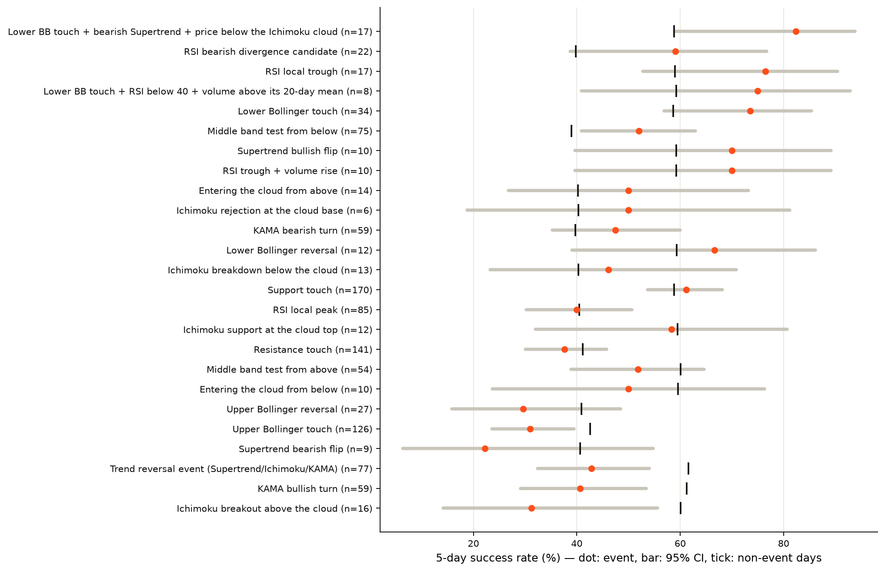
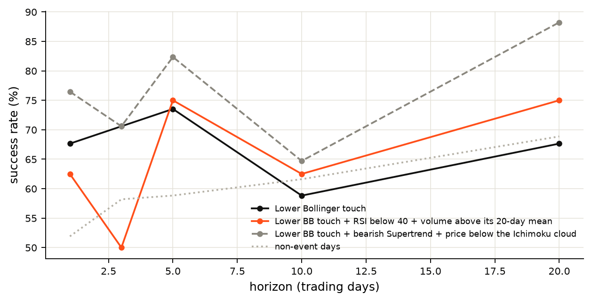
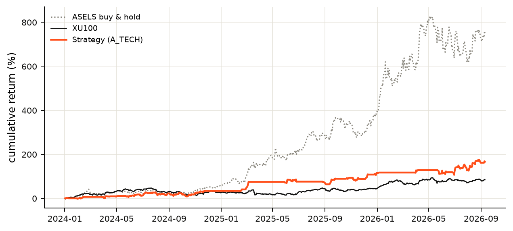

# S3 — Technical reversal events: ASELS

*FinTreX Analyst research report · analysis date (as_of) 2026-09-10 · period 2024-01-01 to 2026-09-10. Generated by `eval/scenario_reports.py` from tool outputs: every number in the text and tables comes from a tool envelope (source calls in the appendix). Educational analysis, not investment advice.*

## Key findings

- Lower Bollinger touches occurred 34 times; 25 were followed by a higher price after 5 days (73.5%; non-event days 58.7%).
- Touches with a bearish Supertrend and price below the cloud (17 events) were historically stronger: 82.4% success, mean +4.65%.
- After multiple-testing correction 0 of 27 event types are significant.
- The pre-registered reversal strategy returned +166.13%: +81.84 pp versus XU100 but -586.03 pp versus holding ASELS.
- Harness decision: WATCH (risk gate PASS_WITH_WARNINGS).

## 1. Question

> What is the 5-day rise rate after lower Bollinger Band touches in ASELS? Compare touches that come with an RSI trough and high volume against touches with a bearish Supertrend and price below the Ichimoku cloud; exclude incomplete recent windows.

*(Instructor's golden question Q3; the original Turkish wording is in `eval/golden_questions.json`.)*

Specification §13: how price behaved after lower Bollinger touches and other technical events, single-indicator events versus combined conditions, and results by market regime.

## 2. Method

- **Event date = confirmation date.** An RSI local trough forms at t−1 and is confirmed at t, so the event is dated t.
  A support/resistance level is known from the day its pivot is confirmed. The Ichimoku Chikou span is not used.
- **Success:** forward 5-day return > 0 for bullish events, < 0 for bearish events. Main horizon 5 trading days;
  1, 3, 5, 10 and 20 days are also reported.
- **Benchmark:** the same horizon on non-event days (baseline rate). Reversal strength = best directional move inside
  the window (maximum favourable excursion). Abnormal return = stock return − XU100 return.
- **Point in time:** only data known at the close of 2026-09-10. **110
  event-horizon pairs** whose forward window was not complete by then are excluded and listed in the tool output
  (`excluded_incomplete_events`) instead of being silently dropped.
- **Multiple testing:** 27 event types tested in one call; Welch p-values of the event vs non-event mean
  difference are adjusted with Bonferroni and Benjamini–Hochberg.
- Indicator parameters equal the instructor's reference scripts (BB 20/2σ, RSI 14 Wilder, KAMA 10/2/30, ATR 10,
  Supertrend 10/3, Ichimoku 9/26/52, volume MA20), verified by parity tests.

## 3. Event families

Columns: successes / failures; 5-day success rate with 95% CI; rate on non-event days; 5-day mean / median return;
mean reversal strength; mean abnormal return vs XU100; Benjamini–Hochberg p. ↑ bullish, ↓ bearish hypothesis.
† n < 5 (insufficient sample), * n < 10 (small sample).

**Bollinger Bands**

| Event | n | Success / failure | Success (5d) [95% CI] | Non-event days | Mean / median | Reversal strength | vs XU100 | p (BH) |
| :--- | ---: | ---: | ---: | ---: | ---: | ---: | ---: | ---: |
| Lower Bollinger reversal ↑ | 12 | 8 / 4 | 66.7% [39%–86%] | 59.3% | +1.52% / +0.80% | 5.56% | -0.21 pp | 0.992 |
| Lower Bollinger touch ↑ | 34 | 25 / 9 | 73.5% [57%–85%] | 58.7% | +2.77% / +3.74% | 6.41% | +0.94 pp | 0.685 |
| Middle band test from above ↑ | 54 | 28 / 26 | 51.9% [39%–65%] | 60.1% | +0.73% / +0.37% | 4.58% | +0.79 pp | 0.665 |
| Middle band test from below ↓ | 75 | 39 / 36 | 52.0% [41%–63%] | 39.0% | +2.12% / -0.30% | 4.03% | +1.82 pp | 0.851 |
| Upper Bollinger touch ↓ | 126 | 39 / 87 | 31.0% [24%–39%] | 42.6% | +2.95% / +2.21% | 2.62% | +1.80 pp | 0.296 |
| Upper Bollinger reversal ↓ | 27 | 8 / 19 | 29.6% [16%–48%] | 40.9% | +2.31% / +2.72% | 3.05% | +1.40 pp | 0.851 |

**RSI**

| Event | n | Success / failure | Success (5d) [95% CI] | Non-event days | Mean / median | Reversal strength | vs XU100 | p (BH) |
| :--- | ---: | ---: | ---: | ---: | ---: | ---: | ---: | ---: |
| RSI local trough ↑ | 17 | 13 / 4 | 76.5% [53%–90%] | 59.0% | +1.83% / +1.02% | 5.12% | +0.65 pp | 0.992 |
| RSI trough + volume rise ↑ | 10 | 7 / 3 | 70.0% [40%–89%] | 59.3% | +1.05% / +1.07% | 4.85% | -0.03 pp | 0.851 |
| RSI local peak ↓ | 85 | 34 / 51 | 40.0% [30%–51%] | 40.5% | +1.53% / +1.86% | 2.94% | +0.91 pp | 0.851 |
| RSI bullish divergence candidate ↑ | 1† | 1 / 0 | 100.0% [21%–100%] | 59.4% | +2.00% / +2.00% | 5.51% | +1.88 pp | – |
| RSI bearish divergence candidate ↓ | 22 | 13 / 9 | 59.1% [39%–77%] | 39.8% | +0.40% / -2.22% | 3.45% | +0.08 pp | 0.755 |

**Supertrend**

| Event | n | Success / failure | Success (5d) [95% CI] | Non-event days | Mean / median | Reversal strength | vs XU100 | p (BH) |
| :--- | ---: | ---: | ---: | ---: | ---: | ---: | ---: | ---: |
| Supertrend bullish flip ↑ | 10 | 7 / 3 | 70.0% [40%–89%] | 59.3% | +2.60% / +1.13% | 5.92% | +2.06 pp | 0.908 |
| Supertrend bearish flip ↓ | 9* | 2 / 7 | 22.2% [6%–55%] | 40.7% | +3.08% / +4.01% | 1.71% | +1.07 pp | 0.685 |

**KAMA**

| Event | n | Success / failure | Success (5d) [95% CI] | Non-event days | Mean / median | Reversal strength | vs XU100 | p (BH) |
| :--- | ---: | ---: | ---: | ---: | ---: | ---: | ---: | ---: |
| KAMA bullish turn ↑ | 59 | 24 / 35 | 40.7% [29%–53%] | 61.2% | +0.12% / -0.44% | 4.79% | -0.25 pp | 0.296 |
| KAMA bearish turn ↓ | 59 | 28 / 31 | 47.5% [35%–60%] | 39.7% | +0.64% / +0.90% | 3.90% | +0.95 pp | 0.665 |

**Ichimoku**

| Event | n | Success / failure | Success (5d) [95% CI] | Non-event days | Mean / median | Reversal strength | vs XU100 | p (BH) |
| :--- | ---: | ---: | ---: | ---: | ---: | ---: | ---: | ---: |
| Ichimoku breakout above the cloud ↑ | 16 | 5 / 11 | 31.2% [14%–56%] | 60.1% | -0.54% / -0.46% | 3.77% | -0.99 pp | 0.665 |
| Ichimoku breakdown below the cloud ↓ | 13 | 6 / 7 | 46.2% [23%–71%] | 40.3% | +1.86% / +0.53% | 3.81% | +1.31 pp | 0.992 |
| Ichimoku rejection at the cloud base ↓ | 6* | 3 / 3 | 50.0% [19%–81%] | 40.3% | -0.20% / +1.46% | 5.01% | +1.32 pp | 0.755 |
| Ichimoku support at the cloud top ↑ | 12 | 7 / 5 | 58.3% [32%–81%] | 59.5% | +0.39% / +0.39% | 4.93% | -0.27 pp | 0.794 |
| Entering the cloud from above ↓ | 14 | 7 / 7 | 50.0% [27%–73%] | 40.2% | +0.02% / +0.43% | 3.85% | -0.17 pp | 0.685 |
| Entering the cloud from below ↑ | 10 | 5 / 5 | 50.0% [24%–76%] | 59.6% | +1.76% / +1.60% | 5.11% | +2.31 pp | 0.992 |

**Support / resistance**

| Event | n | Success / failure | Success (5d) [95% CI] | Non-event days | Mean / median | Reversal strength | vs XU100 | p (BH) |
| :--- | ---: | ---: | ---: | ---: | ---: | ---: | ---: | ---: |
| Support touch ↑ | 170 | 104 / 66 | 61.2% [54%–68%] | 58.8% | +1.93% / +2.11% | 5.35% | +1.37 pp | 0.851 |
| Resistance touch ↓ | 141 | 53 / 88 | 37.6% [30%–46%] | 41.2% | +1.37% / +1.64% | 3.08% | +1.47 pp | 0.685 |

**Combined events and conditions**

| Event | n | Success / failure | Success (5d) [95% CI] | Non-event days | Mean / median | Reversal strength | vs XU100 | p (BH) |
| :--- | ---: | ---: | ---: | ---: | ---: | ---: | ---: | ---: |
| Trend reversal event (Supertrend/Ichimoku/KAMA) ↑ | 77 | 33 / 44 | 42.9% [32%–54%] | 61.6% | +0.18% / -0.43% | 4.67% | -0.20 pp | 0.296 |
| Strong combined reversal event ↑ | 2† | 1 / 1 | 50.0% [9%–91%] | 59.5% | -2.94% / -2.94% | 1.39% | -2.55 pp | 0.755 |
| Lower BB touch + RSI below 40 + volume above its 20-day mean ↑ | 8* | 6 / 2 | 75.0% [41%–93%] | 59.2% | +1.12% / +3.00% | 5.20% | +1.32 pp | 0.851 |
| Lower BB touch + bearish Supertrend + price below the Ichimoku cloud ↑ | 17 | 14 / 3 | 82.4% [59%–94%] | 58.8% | +4.65% / +4.20% | 7.41% | +2.49 pp | 0.296 |

## 4. Single indicator versus combined conditions

| Condition | n | Success (5d) | Mean | Median | Reversal strength |
| :--- | ---: | ---: | ---: | ---: | ---: |
| Lower Bollinger touch | 34 | 73.5% | +2.77% | +3.74% | 6.41% |
| Lower BB touch + RSI below 40 + volume above its 20-day mean | 8 | 75.0% | +1.12% | +3.00% | 5.20% |
| Lower BB touch + bearish Supertrend + price below the Ichimoku cloud | 17 | 82.4% | +4.65% | +4.20% | 7.41% |

Adding the RSI-below-40 and rising-volume condition gives a success rate of 75.0% (higher than the 73.5% of all lower touches), but the sample falls to 8 events. When the Supertrend is bearish and price is below the cloud the success rate is 82.4% (higher; 17 events). The specification's illustrative scenario describes signals failing under this condition; in ASELS over this period the data show the opposite, although the difference is not significant after correction (p (BH) = 0.296).

## 5. Horizon profile

Cell: success rate / mean return.

| Event | 1d | 3d | 5d | 10d | 20d |
| :--- | ---: | ---: | ---: | ---: | ---: |
| Lower Bollinger touch | 68% / +1.1% | 71% / +2.5% | 74% / +2.8% | 59% / +3.3% | 68% / +6.2% |
| Lower Bollinger reversal | 58% / +1.3% | 50% / +0.6% | 67% / +1.5% | 50% / +1.3% | 58% / +3.4% |
| Lower BB touch + RSI below 40 + volume above its 20-day mean | 62% / +1.0% | 50% / +0.5% | 75% / +1.1% | 62% / +3.6% | 75% / +5.1% |
| Lower BB touch + bearish Supertrend + price below the Ichimoku cloud | 76% / +1.7% | 71% / +3.5% | 82% / +4.7% | 65% / +4.5% | 88% / +9.2% |
| RSI trough + volume rise | 60% / +0.7% | 50% / +1.4% | 70% / +1.0% | 40% / +0.8% | 60% / +5.3% |
| Supertrend bullish flip | 50% / +0.7% | 50% / +1.0% | 70% / +2.6% | 70% / +4.5% | 70% / +10.2% |
| Ichimoku breakout above the cloud | 47% / +0.5% | 35% / -0.6% | 31% / -0.5% | 56% / +1.4% | 67% / +5.5% |
| Support touch | 55% / +0.4% | 57% / +1.0% | 61% / +1.9% | 67% / +3.8% | 71% / +6.5% |

## 6. By market regime (5-day success)

| Event | XU100 rising | XU100 falling | Low volatility | High volatility |
| :--- | ---: | ---: | ---: | ---: |
| Lower Bollinger touch | 79% (n=14) | 70% (n=20) | 76% (n=29) | 60% (n=5) |
| Lower Bollinger reversal | 100% (n=5) | 43% (n=7) | 78% (n=9) | 33% (n=3) |
| RSI trough + volume rise | 75% (n=4) | 67% (n=6) | 67% (n=6) | 75% (n=4) |
| Supertrend bullish flip | 62% (n=8) | 100% (n=2) | 70% (n=10) | – |
| Ichimoku breakout above the cloud | 38% (n=13) | 0% (n=3) | 29% (n=14) | 50% (n=2) |

Regime subsets are small and are not a basis for a decision on their own.

## 7. Multiple-testing risk

Of 26 event types, 4 have a raw p < 0.05 for the event vs non-event mean difference; 0 after
Benjamini–Hochberg and 0 after Bonferroni. None of the differences that look significant one by one survives the correction: no event type separates forward returns from non-event days with statistical confidence in this period. The high success rates partly reflect ASELS' strong overall uptrend (non-event days rose 58.7% of the time).

## 8. State as of 2026-09-10

As of 2026-09-10: Supertrend bullish, price above the cloud, KAMA slope flat, RSI 56.9. Events active in the last 5 trading days (since 2026-09-04):
Ichimoku breakout above the cloud, KAMA bullish turn.

| Date | Event | Close | Supertrend | Ichimoku |
| :--- | :--- | ---: | :--- | :--- |
| 2026-09-07 | Trend reversal event (Supertrend/Ichimoku/KAMA) | 392.50 | bullish | above the cloud |
| 2026-09-08 | Middle band test from above | 390.00 | bullish | above the cloud |
| 2026-09-08 | Support touch | 390.00 | bullish | above the cloud |
| 2026-09-09 | Middle band test from below | 402.25 | bullish | above the cloud |
| 2026-09-09 | Resistance touch | 402.25 | bullish | above the cloud |
| 2026-09-10 | Middle band test from above | 398.50 | bullish | above the cloud |
| 2026-09-10 | Resistance touch | 398.50 | bullish | above the cloud |
| 2026-09-10 | Support touch | 398.50 | bullish | above the cloud |

**Support and resistance levels** (pivots of the last 250 bars clustered within 2%, at least two touches)

| Side | Level | Touches | Last touch | Known from | Distance from close |
| :--- | ---: | ---: | :--- | :--- | ---: |
| support | 390.88 | 2 | 2026-07-24 | 2026-07-31 | -1.91% |
| support | 371.88 | 2 | 2026-09-03 | 2026-09-10 | -6.68% |
| support | 352.62 | 2 | 2026-06-05 | 2026-06-12 | -11.51% |
| support | 342.75 | 3 | 2026-07-17 | 2026-07-07 | -13.99% |
| support | 316.00 | 3 | 2026-03-31 | 2026-03-24 | -20.70% |
| resistance | 412.50 | 3 | 2026-08-25 | 2026-07-13 | +3.51% |

## 9. Backtest

Variant `A_TECH` (technical) of the pre-registered rule `REVERSAL_PRESET_V1` (fixed before any result was seen): entry events `BB_LOWER_REVERSAL`, `RSI_TROUGH_VOLUME`, `SUPERTREND_BULLISH_FLIP`, `SUPPORT_TOUCH`; holding period 5 trading days; signal at the close of day t, trade at the open of t+1; cost 10 bp per trade.

| Measure | Value |
| :--- | ---: |
| Period | 2024-01-02 to 2026-09-10 |
| Signals / closed trades | 51 / 50 |
| Win rate | 66.0% |
| Cumulative return (nominal) | +166.13% |
| Real return (CPI-deflated) | +15.38% |
| Difference vs XU100 | +81.84 pp |
| Difference vs asels buy & hold | -586.03 pp |
| Sharpe (rf = 0 / policy rate) | 1.57 / 0.15 |
| Maximum drawdown | -14.41% |
| In sample (2024-01-02 to 2025-12-31) | +116.32%, Sharpe 1.72 |
| Out of sample (2026-01-02 to 2026-09-10) | +23.03%, Sharpe 1.21 |

The strategy finished +81.84 pp versus XU100 but -586.03 pp versus simply holding ASELS: short (5-day) reversal trades miss most of a strong trend. Out of sample the return was +23.03%.

## 10. Harness decision

The same question was run through the 17-state harness (scenario planner + rule-based explainer). Final analytical state: **WATCH**; risk gate **PASS_WITH_WARNINGS** (4 findings; types: MISSING_DAY, SMALL_SAMPLE, SPEECH_NOT_AVAILABLE). 14 tool calls, 0 invalid. The explanation cites 6 committed evidence items (E1, E3, E10, E11, E14, E16) and passed the output validator on the first attempt. The product writes its explanation in Turkish; it is stored verbatim in the episodic record above and can be replayed byte for byte. A `TECHNICAL_REVERSAL_CANDIDATE` label requires the current event to be supported by historical and
backtest evidence; when that is not the case the system stays with monitoring.

## 11. Limitations and differences from the instructor's script

- In the instructor's S3 script the Supertrend final bands are seeded with a NaN ATR, so the Supertrend never starts
  and the script produces no Supertrend flips. Here the recursion starts at the first valid ATR bar (identical to the
  script's recursion from that start, tested); this period has 10 bullish
  and 9 bearish flips.
- The script's forward returns use `dropna`, silently dropping incomplete windows; here they are listed separately.
- A KAMA–price cross is mathematically the same as a KAMA slope turn; it is not counted as a separate event (to avoid
  double counting and inflating the multiple-testing family).
- Prices are dividend- and split-adjusted and anchored to the analysis date; truncated bars and spurious rows found in
  yfinance are corrected in the primary source.
- One stock, one period: results do not generalise to other stocks or periods.

## Appendix — source tool calls

Analysis `A-20261127222528081520-a668d0e1` · decision `D-20261127222528081520-a668d0e1` · episodic record `reports/scenarios/episodic_q3.sqlite` (replay: `python -m bistharness.harness replay --decision ...` with that memory file, or the web UI).

Data version (sha256, first 12): fundamentals `41b26fc0d037`, macro `7c8f1f74f52e`, news `cfba92ab38d9`, prices `330c06c5e4c9`

| State | Tool | Origin | call_id |
| :--- | :--- | :--- | :--- |
| LOAD_MARKET_DATA | `get_stock_history` | plan | `fb095b10e8b7cf42` |
| LOAD_MARKET_DATA | `get_index_history` | plan | `d27ba4b9d88d0542` |
| CHECK_DATA_QUALITY | `check_data_quality` | harness | `eebe00f71dbf8add` |
| CALCULATE_TECHNICALS | `calculate_indicators` | plan | `720fad9d33b24805` |
| CALCULATE_TECHNICALS | `find_support_resistance` | plan | `a554d34bfdab8dab` |
| RUN_PATTERN_AND_REVERSAL_ANALYSIS | `detect_reversal_events` | plan | `b6dcaeb9ede50db4` |
| LOAD_NEWS_AND_SPEECH_CONTEXT | `get_news_events` | plan | `e36418085143d0f9` |
| LOAD_NEWS_AND_SPEECH_CONTEXT | `get_speech_features` | plan | `a0ee9081824bc781` |
| BUILD_EVIDENCE | `build_evidence_bundle` | harness | `89042b1bce395c02` |
| PREVIEW_STRATEGIES | `run_backtest` | plan | `1488c0c2c4de1609` |
| RUN_BACKTEST | `run_backtest` | plan | `59a31b59aa84f500` |
| RUN_BACKTEST | `build_evidence_bundle` | harness | `c96d02d480e4aaa1` |
| RISK_GATE | `check_data_quality` | harness | `2f7fbc0f29d78ceb` |
| RISK_GATE | `build_evidence_bundle` | harness | `ca0b0d83e4333a7e` |
