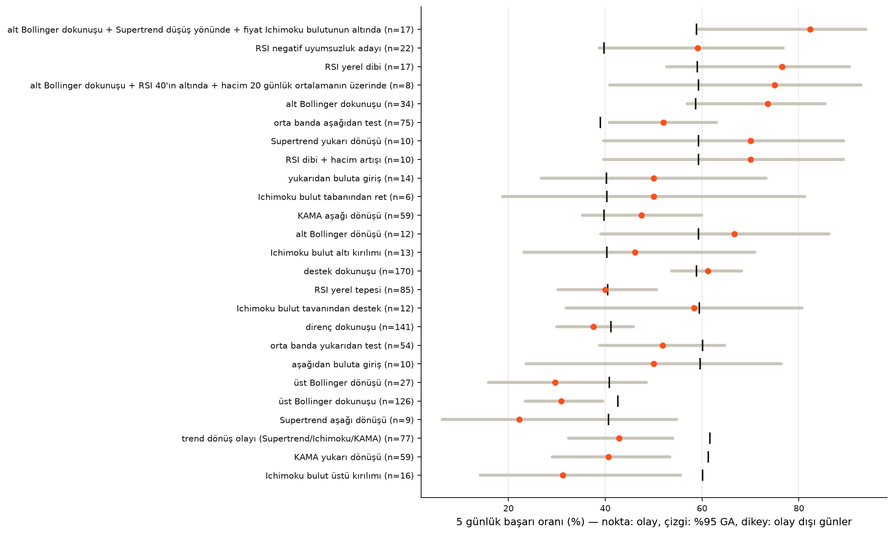
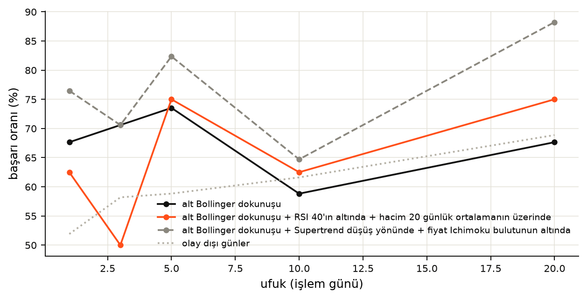
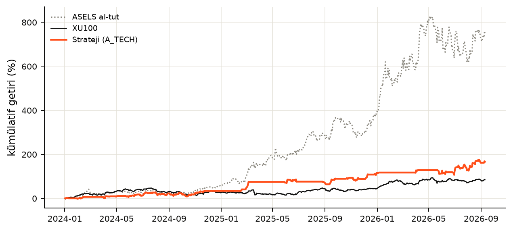

# S3 — Teknik dönüş olayları: ASELS

*FinTreX Analyst senaryo raporu · analiz tarihi 10.09.2026 · dönem 01.01.2024 – 10.09.2026.
Bu rapor `eval/scenario_reports.py` ile araç çıktılarından üretilmiştir; metindeki ve tablolardaki her sayı bir araç
zarfından gelir (kaynak çağrılar ekte). Eğitsel bir analizdir, yatırım tavsiyesi değildir.*

## Ana bulgular

- Alt Bollinger dokunuşu 34 kez oluştu; 5 gün sonra 25 tanesinde fiyat yükseldi (%73,5; olay dışı günlerde %58,7).
- Supertrend düşüşte ve fiyat bulutun altındayken gelen dokunuşlar (17 olay) tarihsel olarak daha güçlü: %82,4 başarı, ortalama +%4,65.
- Çoklu test düzeltmesinden sonra 27 olay türünden 0 tanesi anlamlı; yüksek oranların bir kısmı hissenin genel yükselişinden geliyor.
- Önceden sabitlenmiş dönüş stratejisi +%166,13 kazandırdı; XU100'ün 81,84 puan önünde, fakat ASELS'i elde tutmanın 586,03 puan gerisinde.
- Harness kararı: WATCH (risk kapısı PASS_WITH_WARNINGS).

## 1. Soru

> ASELS'te alt Bollinger dokunuşlarından sonra 5 günlük yükseliş oranı nedir? RSI dibi ve yüksek hacimle birlikte gelen dokunuşlar ile düşüş yönlü Supertrend ve Ichimoku bulutu altındaki dokunuşları karşılaştır; tamamlanmamış son pencereleri hariç tut.

Şartname §13: ASELS'te alt Bollinger dokunuşlarının ve diğer teknik olayların ardından fiyatın tarihsel olarak nasıl
davrandığı; tek göstergeli olayların birleşik koşullarla karşılaştırılması; piyasa rejimine göre sonuçlar.

## 2. Yöntem

- **Olay tarihi = teyit tarihi.** Örneğin RSI yerel dibi t−1'de oluşur, t'de teyit edilir; olay t sayılır. Destek/direnç
  seviyesi pivotun teyit edildiği günden itibaren bilinir. Ichimoku Chikou kullanılmaz.
- **Başarı tanımı:** yükseliş olayında 5 günlük ileri getiri > 0, düşüş olayında < 0. Ana ufuk 5 işlem günü; 1, 3, 5, 10 ve 20 gün ayrıca raporlanır.
- **Kıyas:** aynı ufukta olay olmayan günlerin getirisi (olay dışı baz oran). Dönüş gücü = pencere içindeki en iyi
  yönlü hareket (MFE). Anormal getiri = hisse getirisi − XU100 getirisi.
- **Point-in-time:** tüm veriler 10.09.2026 kapanışına kadar bilinenlerdir. İleri penceresi bu tarihe kadar
  dolmamış **110 olay–ufuk çifti** istatistiğe alınmadı (sessiz `dropna` yok; liste
  araç çıktısında `excluded_incomplete_events`).
- **Çoklu test:** tek çağrıda 27 olay türü sınandı; olay–olay dışı ortalama farkının Welch p-değerleri
  Bonferroni ve Benjamini–Hochberg ile düzeltildi.
- Göstergeler hocanın referans parametreleriyle aynıdır (BB 20/2σ, RSI 14 Wilder, KAMA 10/2/30, ATR 10, Supertrend 10/3,
  Ichimoku 9/26/52, hacim MA20; parity testli).

## 3. Olay aileleri

Sütunlar: başarılı/başarısız sayısı; 5 günlük başarı oranı ve %95 güven aralığı; olay dışı günlerdeki oran;
5 günlük ortalama/medyan getiri; ortalama dönüş gücü (MFE); XU100'e göre ortalama anormal getiri; BH düzeltilmiş p.
↑ yükseliş, ↓ düşüş hipotezi. † n < 5 (yetersiz örneklem), * n < 10 (küçük örneklem).

**Bollinger bantları**

| Olay | n | Başarılı / başarısız | Başarı (5g) [%95 GA] | Olay dışı | Ort. / medyan | Dönüş gücü | XU100'e göre | p (BH) |
| :--- | ---: | ---: | ---: | ---: | ---: | ---: | ---: | ---: |
| alt Bollinger dönüşü ↑ | 12 | 8/4 | %66,7 [%39–%86] | %59,3 | +%1,52 / +%0,80 | %5,56 | -%0,21 | 0,992 |
| alt Bollinger dokunuşu ↑ | 34 | 25/9 | %73,5 [%57–%85] | %58,7 | +%2,77 / +%3,74 | %6,41 | +%0,94 | 0,685 |
| orta banda yukarıdan test ↑ | 54 | 28/26 | %51,9 [%39–%65] | %60,1 | +%0,73 / +%0,37 | %4,58 | +%0,79 | 0,665 |
| orta banda aşağıdan test ↓ | 75 | 39/36 | %52,0 [%41–%63] | %39,0 | +%2,12 / -%0,30 | %4,03 | +%1,82 | 0,851 |
| üst Bollinger dokunuşu ↓ | 126 | 39/87 | %31,0 [%24–%39] | %42,6 | +%2,95 / +%2,21 | %2,62 | +%1,80 | 0,296 |
| üst Bollinger dönüşü ↓ | 27 | 8/19 | %29,6 [%16–%48] | %40,9 | +%2,31 / +%2,72 | %3,05 | +%1,40 | 0,851 |

**RSI**

| Olay | n | Başarılı / başarısız | Başarı (5g) [%95 GA] | Olay dışı | Ort. / medyan | Dönüş gücü | XU100'e göre | p (BH) |
| :--- | ---: | ---: | ---: | ---: | ---: | ---: | ---: | ---: |
| RSI yerel dibi ↑ | 17 | 13/4 | %76,5 [%53–%90] | %59,0 | +%1,83 / +%1,02 | %5,12 | +%0,65 | 0,992 |
| RSI dibi + hacim artışı ↑ | 10 | 7/3 | %70,0 [%40–%89] | %59,3 | +%1,05 / +%1,07 | %4,85 | -%0,03 | 0,851 |
| RSI yerel tepesi ↓ | 85 | 34/51 | %40,0 [%30–%51] | %40,5 | +%1,53 / +%1,86 | %2,94 | +%0,91 | 0,851 |
| RSI pozitif uyumsuzluk adayı ↑ | 1† | 1/0 | %100,0 [%21–%100] | %59,4 | +%2,00 / +%2,00 | %5,51 | +%1,88 | – |
| RSI negatif uyumsuzluk adayı ↓ | 22 | 13/9 | %59,1 [%39–%77] | %39,8 | +%0,40 / -%2,22 | %3,45 | +%0,08 | 0,755 |

**Supertrend**

| Olay | n | Başarılı / başarısız | Başarı (5g) [%95 GA] | Olay dışı | Ort. / medyan | Dönüş gücü | XU100'e göre | p (BH) |
| :--- | ---: | ---: | ---: | ---: | ---: | ---: | ---: | ---: |
| Supertrend yukarı dönüşü ↑ | 10 | 7/3 | %70,0 [%40–%89] | %59,3 | +%2,60 / +%1,13 | %5,92 | +%2,06 | 0,908 |
| Supertrend aşağı dönüşü ↓ | 9* | 2/7 | %22,2 [%6–%55] | %40,7 | +%3,08 / +%4,01 | %1,71 | +%1,07 | 0,685 |

**KAMA**

| Olay | n | Başarılı / başarısız | Başarı (5g) [%95 GA] | Olay dışı | Ort. / medyan | Dönüş gücü | XU100'e göre | p (BH) |
| :--- | ---: | ---: | ---: | ---: | ---: | ---: | ---: | ---: |
| KAMA yukarı dönüşü ↑ | 59 | 24/35 | %40,7 [%29–%53] | %61,2 | +%0,12 / -%0,44 | %4,79 | -%0,25 | 0,296 |
| KAMA aşağı dönüşü ↓ | 59 | 28/31 | %47,5 [%35–%60] | %39,7 | +%0,64 / +%0,90 | %3,90 | +%0,95 | 0,665 |

**Ichimoku**

| Olay | n | Başarılı / başarısız | Başarı (5g) [%95 GA] | Olay dışı | Ort. / medyan | Dönüş gücü | XU100'e göre | p (BH) |
| :--- | ---: | ---: | ---: | ---: | ---: | ---: | ---: | ---: |
| Ichimoku bulut üstü kırılımı ↑ | 16 | 5/11 | %31,2 [%14–%56] | %60,1 | -%0,54 / -%0,46 | %3,77 | -%0,99 | 0,665 |
| Ichimoku bulut altı kırılımı ↓ | 13 | 6/7 | %46,2 [%23–%71] | %40,3 | +%1,86 / +%0,53 | %3,81 | +%1,31 | 0,992 |
| Ichimoku bulut tabanından ret ↓ | 6* | 3/3 | %50,0 [%19–%81] | %40,3 | -%0,20 / +%1,46 | %5,01 | +%1,32 | 0,755 |
| Ichimoku bulut tavanından destek ↑ | 12 | 7/5 | %58,3 [%32–%81] | %59,5 | +%0,39 / +%0,39 | %4,93 | -%0,27 | 0,794 |
| yukarıdan buluta giriş ↓ | 14 | 7/7 | %50,0 [%27–%73] | %40,2 | +%0,02 / +%0,43 | %3,85 | -%0,17 | 0,685 |
| aşağıdan buluta giriş ↑ | 10 | 5/5 | %50,0 [%24–%76] | %59,6 | +%1,76 / +%1,60 | %5,11 | +%2,31 | 0,992 |

**Destek / direnç**

| Olay | n | Başarılı / başarısız | Başarı (5g) [%95 GA] | Olay dışı | Ort. / medyan | Dönüş gücü | XU100'e göre | p (BH) |
| :--- | ---: | ---: | ---: | ---: | ---: | ---: | ---: | ---: |
| destek dokunuşu ↑ | 170 | 104/66 | %61,2 [%54–%68] | %58,8 | +%1,93 / +%2,11 | %5,35 | +%1,37 | 0,851 |
| direnç dokunuşu ↓ | 141 | 53/88 | %37,6 [%30–%46] | %41,2 | +%1,37 / +%1,64 | %3,08 | +%1,47 | 0,685 |

**Birleşik olaylar ve koşullar**

| Olay | n | Başarılı / başarısız | Başarı (5g) [%95 GA] | Olay dışı | Ort. / medyan | Dönüş gücü | XU100'e göre | p (BH) |
| :--- | ---: | ---: | ---: | ---: | ---: | ---: | ---: | ---: |
| trend dönüş olayı (Supertrend/Ichimoku/KAMA) ↑ | 77 | 33/44 | %42,9 [%32–%54] | %61,6 | +%0,18 / -%0,43 | %4,67 | -%0,20 | 0,296 |
| güçlü birleşik dönüş olayı ↑ | 2† | 1/1 | %50,0 [%9–%91] | %59,5 | -%2,94 / -%2,94 | %1,39 | -%2,55 | 0,755 |
| alt Bollinger dokunuşu + RSI 40'ın altında + hacim 20 günlük ortalamanın üzerinde ↑ | 8* | 6/2 | %75,0 [%41–%93] | %59,2 | +%1,12 / +%3,00 | %5,20 | +%1,32 | 0,851 |
| alt Bollinger dokunuşu + Supertrend düşüş yönünde + fiyat Ichimoku bulutunun altında ↑ | 17 | 14/3 | %82,4 [%59–%94] | %58,8 | +%4,65 / +%4,20 | %7,41 | +%2,49 | 0,296 |

## 4. Tek gösterge ve birleşik koşullar

| Koşul | n | Başarı (5g) | Ortalama | Medyan | Dönüş gücü |
| :--- | ---: | ---: | ---: | ---: | ---: |
| alt Bollinger dokunuşu | 34 | %73,5 | +%2,77 | +%3,74 | %6,41 |
| alt Bollinger dokunuşu + RSI 40'ın altında + hacim 20 günlük ortalamanın üzerinde | 8 | %75,0 | +%1,12 | +%3,00 | %5,20 |
| alt Bollinger dokunuşu + Supertrend düşüş yönünde + fiyat Ichimoku bulutunun altında | 17 | %82,4 | +%4,65 | +%4,20 | %7,41 |

RSI düşük + hacim artışı koşulu eklendiğinde başarı oranı %75,0 (tek başına alt bant dokunuşu %73,5; daha yüksek), fakat örneklem 8 olaya düşüyor. Supertrend düşüşte ve fiyat bulutun altındayken başarı oranı %82,4 (daha yüksek; 17 olay). Şartnamedeki örnek senaryoda bu koşulda sinyallerin sık başarısız olduğu anlatılıyordu; ASELS'in bu döneminde veri tersini gösteriyor, ancak fark düzeltme sonrası anlamlı değil (p (BH) = 0,296).

## 5. Ufuk profili

Hücre: başarı oranı / ortalama getiri.

| Olay | 1g | 3g | 5g | 10g | 20g |
| :--- | ---: | ---: | ---: | ---: | ---: |
| alt Bollinger dokunuşu | %68 / +%1,1 | %71 / +%2,5 | %74 / +%2,8 | %59 / +%3,3 | %68 / +%6,2 |
| alt Bollinger dönüşü | %58 / +%1,3 | %50 / +%0,6 | %67 / +%1,5 | %50 / +%1,3 | %58 / +%3,4 |
| alt Bollinger dokunuşu + RSI 40'ın altında + hacim 20 günlük ortalamanın üzerinde | %62 / +%1,0 | %50 / +%0,5 | %75 / +%1,1 | %62 / +%3,6 | %75 / +%5,1 |
| alt Bollinger dokunuşu + Supertrend düşüş yönünde + fiyat Ichimoku bulutunun altında | %76 / +%1,7 | %71 / +%3,5 | %82 / +%4,7 | %65 / +%4,5 | %88 / +%9,2 |
| RSI dibi + hacim artışı | %60 / +%0,7 | %50 / +%1,4 | %70 / +%1,0 | %40 / +%0,8 | %60 / +%5,3 |
| Supertrend yukarı dönüşü | %50 / +%0,7 | %50 / +%1,0 | %70 / +%2,6 | %70 / +%4,5 | %70 / +%10,2 |
| Ichimoku bulut üstü kırılımı | %47 / +%0,5 | %35 / -%0,6 | %31 / -%0,5 | %56 / +%1,4 | %67 / +%5,5 |
| destek dokunuşu | %55 / +%0,4 | %57 / +%1,0 | %61 / +%1,9 | %67 / +%3,8 | %71 / +%6,5 |

## 6. Piyasa rejimine göre (5 günlük başarı)

| Olay | XU100 yükselen | XU100 düşen | Düşük volatilite | Yüksek volatilite |
| :--- | ---: | ---: | ---: | ---: |
| alt Bollinger dokunuşu | %79 (n=14) | %70 (n=20) | %76 (n=29) | %60 (n=5) |
| alt Bollinger dönüşü | %100 (n=5) | %43 (n=7) | %78 (n=9) | %33 (n=3) |
| RSI dibi + hacim artışı | %75 (n=4) | %67 (n=6) | %67 (n=6) | %75 (n=4) |
| Supertrend yukarı dönüşü | %62 (n=8) | %100 (n=2) | %70 (n=10) | – |
| Ichimoku bulut üstü kırılımı | %38 (n=13) | %0 (n=3) | %29 (n=14) | %50 (n=2) |

Rejim alt kümeleri küçüktür; tek başına karar dayanağı değildir.

## 7. Çoklu test riski

26 olay türünün 4 tanesinde olay ile olay dışı ortalama farkı ham p < 0,05; Benjamini–Hochberg sonrası
0, Bonferroni sonrası 0. Tek tek bakıldığında anlamlı görünen farkların hiçbiri düzeltme sonrası anlamlı kalmıyor: bu dönemde hiçbir olay türü, getiriyi olay dışı günlerden istatistiksel olarak ayıracak güçte değil. Yüksek başarı oranları kısmen ASELS'in bu dönemdeki güçlü genel yükselişinden geliyor (olay dışı günlerde de yükseliş oranı %58,7).

## 8. 10.09.2026 itibarıyla güncel durum

10.09.2026 itibarıyla ASELS Supertrend yönü yükseliş, fiyat Ichimoku bulutun üstünde, KAMA eğimi yatay.

Son 5 işlem gününde (04.09.2026 sonrası)
etkin olaylar: Ichimoku bulut üstü kırılımı, KAMA yukarı dönüşü.

| Tarih | Olay | Kapanış | Supertrend | Ichimoku |
| :--- | :--- | ---: | :--- | :--- |
| 07.09.2026 | trend dönüş olayı (Supertrend/Ichimoku/KAMA) | 392,50 | yükseliş | bulut üstü |
| 08.09.2026 | orta banda yukarıdan test | 390,00 | yükseliş | bulut üstü |
| 08.09.2026 | destek dokunuşu | 390,00 | yükseliş | bulut üstü |
| 09.09.2026 | orta banda aşağıdan test | 402,25 | yükseliş | bulut üstü |
| 09.09.2026 | direnç dokunuşu | 402,25 | yükseliş | bulut üstü |
| 10.09.2026 | orta banda yukarıdan test | 398,50 | yükseliş | bulut üstü |
| 10.09.2026 | direnç dokunuşu | 398,50 | yükseliş | bulut üstü |
| 10.09.2026 | destek dokunuşu | 398,50 | yükseliş | bulut üstü |

- 10.09.2026 itibarıyla en yakın direnç bölgesi 412,50 TL (3 dokunuş, 3 etkili tepki, son dokunuş 25.08.2026); fiyata uzaklık +%3,51.
- 10.09.2026 itibarıyla en yakın destek bölgesi 390,88 TL (2 dokunuş, 2 etkili tepki, son dokunuş 24.07.2026); fiyata uzaklık -%1,91.
- Son 250 barda 6 seviye kümelendi (≥2 dokunuş, %2 tolerans).

## 9. Backtest

Strateji önceden sabitlenmiş `REVERSAL_PRESET_V1` kuralıdır (sonuçlara bakılmadan seçildi): giriş olayları `BB_LOWER_REVERSAL`, `RSI_TROUGH_VOLUME`, `SUPERTREND_BULLISH_FLIP`, `SUPPORT_TOUCH`; elde tutma 5 işlem günü; sinyal t kapanışında, işlem t+1 açılışında; maliyet 10 baz puan.

| Ölçüt | Değer |
| :--- | ---: |
| Dönem | 02.01.2024 – 10.09.2026 |
| Kapanan işlem / kazanan oranı | 50 / %66,0 |
| Kümülatif getiri (nominal) | +%166,13 |
| Reel getiri (TÜFE) | +%15,38 |
| XU100'e göre fark | 81,84 puan |
| Al-tut'a göre fark | -586,03 puan |
| Sharpe (rf = 0 / politika faizi) | 1,57 / 0,15 |
| En büyük düşüş | -%14,41 |
| Örneklem içi (02.01.2024 – 31.12.2025) | +%116,32, Sharpe 1,72 |
| Örneklem dışı (02.01.2026 – 10.09.2026) | +%23,03, Sharpe 1,21 |

Strateji XU100'ün 81,84 puan önünde kaldı, ancak ASELS'i baştan sona elde tutmanın 586,03 puan gerisinde: güçlü yükselen bir hissede kısa (5 günlük) dönüş işlemleri trendin büyük kısmını kaçırıyor. Örneklem dışı dönemde getiri +%23,03.

## 10. Harness kararı

Aynı soru 17 adımlı harness'tan geçirildi (senaryo planlayıcı + kural tabanlı açıklayıcı): **WATCH**,
risk kapısı **PASS_WITH_WARNINGS** (4 bulgu; türler: MISSING_DAY, SMALL_SAMPLE, SPEECH_NOT_AVAILABLE).
14 araç çağrısı, 0 geçersiz. Aday etiketi (`TECHNICAL_REVERSAL_CANDIDATE`) için
güncel olayın tarihsel ve backtest kanıtıyla desteklenmesi gerekir; bu koşul sağlanmadığında sistem izleme ile yetinir.

## 11. Sınırlar ve hocanın betiğiyle farklar

- Hocanın S3 betiğinde Supertrend son bantları NaN ATR ile tohumlandığından hiç başlamaz; bu yüzden betik Supertrend
  dönüşü üretmez. Bizde özyineleme ilk geçerli ATR barından başlar (aynı başlangıçla betikle birebir, testli); bu
  dönemde 10 yukarı ve 9 aşağı dönüş var.
- Betikteki ileri getiri `dropna` ile eksik pencereleri sessizce atar; bizde eksik pencereler ayrı listelenir.
- KAMA–fiyat kesişimi KAMA eğim dönüşüyle matematiksel olarak aynıdır; çift sayım ve çoklu test şişmesini önlemek için
  ayrı olay sayılmadı.
- Fiyat serisi temettü ve bedelsiz düzeltmelidir ve analiz tarihine çapalıdır; yfinance'teki kesik bar ve sahte satır
  sorunları birincil kaynakta düzeltilmiştir (CLAUDE.md §11).
- Tek hisse, tek dönem: sonuçlar başka hisselere ya da döneme genellenemez.

## Ek — kaynak araç çağrıları

Analiz `A-20261127012125750470-a668d0e1` · karar `D-20261127012125750470-a668d0e1` · episodik kayıt `reports/scenarios/episodic_q3.sqlite`.

Veri sürümü (sha256, ilk 12): fundamentals `41b26fc0d037`, macro `7c8f1f74f52e`, news `cfba92ab38d9`, prices `330c06c5e4c9`

| Adım | Araç | Kaynak | call_id |
| :--- | :--- | :--- | :--- |
| LOAD_MARKET_DATA | `get_stock_history` | plan | `fb095b10e8b7cf42` |
| LOAD_MARKET_DATA | `get_index_history` | plan | `d27ba4b9d88d0542` |
| CHECK_DATA_QUALITY | `check_data_quality` | harness | `eebe00f71dbf8add` |
| CALCULATE_TECHNICALS | `calculate_indicators` | plan | `720fad9d33b24805` |
| CALCULATE_TECHNICALS | `find_support_resistance` | plan | `a554d34bfdab8dab` |
| RUN_PATTERN_AND_REVERSAL_ANALYSIS | `detect_reversal_events` | plan | `b6dcaeb9ede50db4` |
| LOAD_NEWS_AND_SPEECH_CONTEXT | `get_news_events` | plan | `e36418085143d0f9` |
| LOAD_NEWS_AND_SPEECH_CONTEXT | `get_speech_features` | plan | `a0ee9081824bc781` |
| BUILD_EVIDENCE | `build_evidence_bundle` | harness | `b97ad3c764c9518a` |
| PREVIEW_STRATEGIES | `run_backtest` | plan | `1488c0c2c4de1609` |
| RUN_BACKTEST | `run_backtest` | plan | `59a31b59aa84f500` |
| RUN_BACKTEST | `build_evidence_bundle` | harness | `f475bd172a52705e` |
| RISK_GATE | `check_data_quality` | harness | `2f7fbc0f29d78ceb` |
| RISK_GATE | `build_evidence_bundle` | harness | `904d88eecd7d0dfb` |
